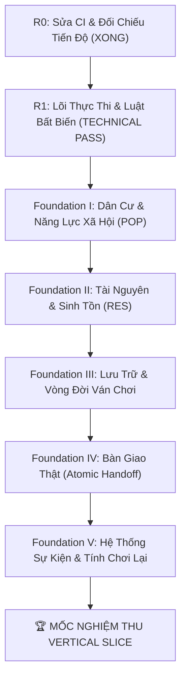

# Bản Đồ Lộ Trình Kỹ Thuật Tổng Thể (MASTER_ROADMAP.md)

## Current runtime checkpoint — PR30 planning checkpoints released

Main base `07dbdd97ae144c28cb13245c0c628dbddd8d4eba`, merge [PR29](https://github.com/tanntran2000/Build-Settlement/pull/29), has the playable `/?mode=tiles` slice: sample terrain tiles, build/upgrade/replace/pause, shared WF, Wheat/Food production, Logging/Mine, Goods Requirement service without Goods inventory, Market capacity, tax/upkeep/revenue and Food/Happiness. Main CI39397236232 passed665unit38browser; this is PR29 evidence, not an R3 acceptance claim. Classic Weekly/R1 remain separate. The older NOT IMPLEMENTED/construction/Gold-income/consumption descriptions below are historical checkpoints; they do not describe mode=tiles after PR29. No whole POP/RES module or full game completion is claimed.

Recipes/Food coefficients retain their approved scope; the new PR29 economics, initialization, rounding and building policies are **implementation TRIAL**, not retrospectively approved balance. UI/UX polish and pixel art remain deferred until core foundations are ready. Law, Tension/crisis, full economy effects, live social groups and migration remain outside this runtime slice.

[R3-TILE-SAVE-01 spec](superpowers/specs/2026-10-20-tile-trial-save.md) / [plan](superpowers/plans/2026-10-20-tile-trial-save.md) is released in [PR30](https://github.com/tanntran2000/Build-Settlement/pull/30), merge `039fc82f80d16a5fb7e1bf784d279785b78fd1e4`, audited head `757570c603bebb7f026413e610a4252b781212b1`, identical tree `e36845acebd7039ac00c738c0b1b9dfb39bba06e`. [Main CI39407997417](https://github.com/tanntran2000/Build-Settlement/actions/runs/39407997417) passed683unit/21files and43browser, lint/typecheck/build/audit0. Manual planning-only JSON export/import has exact version/ruleset/map validation, atomic load, fresh revision and async-read guards. This evidence closes the bounded checkpoint slice, not full R3: autosave/cloud save, R1 migration, report/history persistence and NewGame+ remain open. Existing full-lifecycle checklists stay open; no new balance is introduced. The separate [QA corrections](superpowers/specs/2026-10-20-qa-report-transition-fixes.md) address reported UI/presentation findings and require their own exact-candidate checks.

## Current Goods decision — approved design flow, NOT IMPLEMENTED

Base main đã xác minh: `beb963fcb592d22db5ae430373aca4c6fd70390d` (PR28). [Goods flow và authority](design/TENSION-CRISIS-GOLD-DECISIONS-01.md#goods-requirement-flow--later-approved-clarification): **Goods vẫn là Requirement, không có kho Goods**. Building dùng Wood/Iron một lần mỗi End Week; nhu cầu = tổng dân × định mức chưa chốt, phần phục vụ bị giới hạn bởi công suất Market; Goods % = phục vụ / nhu cầu × 100% khi nhu cầu > 0. Market cấp cao phục vụ nhiều dân hơn, không tăng định mức nhu cầu. Dùng cùng kết quả tuần cho Gold/Happiness, không trừ nguyên liệu lần hai hoặc tự nhân Market thêm vào doanh thu.

Physical inventory hiện hành/đích là 5 loại Wheat/Gold/Wood/Iron/Food. Các target 6 kho có Goods bên dưới là lịch sử đã supersede; catalog tĩnh vẫn snapshot cũ, chưa sửa UI/source. Recipe, định mức, capacity theo LV, hệ số/phase Gold-Happiness, xử lý dư công suất, zero population/demand, rounding, giá và chia 25% chưa duyệt. Food/effect và Tension giữ nguyên; không Law/migration/runtime mới. Gói hiện tại chỉ đồng bộ 8 tài liệu rồi kiểm tra, audit và CI theo gate thường; các checkpoint trước giữ bối cảnh lịch sử.

## PR28 design checkpoint — Tension/crisis/Gold, preserved

Base main đã xác minh: `d89a858c7eb5d29829538423eec8238797801875` (PR27). [Decision Record 01](design/TENSION-CRISIS-GOLD-DECISIONS-01.md) là nguồn đối chiếu quyết định mới: **4 Status chung thành phố Happiness / Security / Corruption / Tension**; Food/Goods vẫn là Requirements, khác kho vật lý. Tension không bằng `100 − Happiness`; miền/clamp Tension 0–100 vừa duyệt cho trial, initial/precision chưa duyệt. Ba nhóm xã hội không đổi, không thêm class bars hoặc migration.

Mốc thiếu Food và H < 30 trong 3 tuần liên tiếp nay mở **yêu sách nghiêm trọng**, không trực tiếp rebellion. Trial đã duyệt: cảnh báo T ≥ 50 hoặc thiếu Food và H < 30; protest T ≥ 75 sau 2 tuần demand chưa giải quyết; rebellion T ≥ 90 sau 2 tuần protest chưa giải quyết; cửa sổ cuối 4 tuần; tối đa một bậc leo thang mỗi End Week. Công thức trial mới duyệt: `pressure = 8s + 6u + 4x`; `recovery = 4 × min(1 − s, 1 − u) × (1 − x)`; `T_next = clamp(T_prior + pressure − recovery − EventRelief, 0, 100)`. `s/u/x` là tỷ lệ thiếu Food/upkeep chưa trả/gánh nặng thuế dư, miền 0–1. Mapping thuế, zero-demand/due, Event relief cụ thể, phục hồi hai tuần/bậc, cooldown, trigger tài chính và semantics xử thua chưa duyệt. Đề xuất cứu nguyên nhân tại hạn cuối phải được xét trước thua vẫn cần chốt.

Ví dụ điều kiện không Food, trả đủ upkeep, thuế trung tính, không Event relief và H 80 / T 0 minh họa: T tăng 8/tuần; demand tuần 7 → protest tuần 10 → rebellion tuần 12 → hết cửa sổ cuối tuần 16. Đây không phải initialization hoặc timeline chung.

Gold: thuế; Goods contribution theo fulfillment từ demand tổng dân và capacity Market như clarification phía trên; explore/combat. Chi: xây dựng một lần, upkeep riêng từng building tăng theo level của chính nó, quân đội và Market purchases. Khoản 1 Gold/mẻ Farm được credit vào upkeep **cùng Farm/cùng tuần**: `extra = max(0, upkeep − batch Gold paid)`, không hoàn chênh lệch hoặc thu trùng. Đây là thiết kế, chưa chạy; hệ số thuế/giá/phí/upkeep/quân đội và Gold âm/nợ vẫn pending.

**NOT IMPLEMENTED:** không đổi source, tests, schema, CI/dependencies hoặc công thức Food/Happiness/Faltering/Flourishing. Runtime vẫn 5 stock PR26, chưa consumption/Status/Gold income/upkeep/crisis. Catalog tĩnh PR25 còn snapshot 3 Status; cập nhật UI cần WP riêng. Đây là checkpoint PR28 đã merge sau audit/CI; gói Goods mới và gates nằm ở mục đầu, không mở rộng runtime/deploy/ZIP. Law vẫn DEFERRED. Các checkpoint bên dưới giữ bối cảnh lịch sử và chỉ được supersede trong phạm vi nêu rõ.

## Runtime implementation evidence — PR #26 merge, contract unchanged

Runtime base PR26 đã xác minh: `02e58b1fe6b9ef42c048cd4fede8bb5bc5aadf4d`, merge [PR #26](https://github.com/tanntran2000/Build-Settlement/pull/26) từ audited head `ef24fa2ca5505a8b5d59665fc7df5435989f6371`, base sau PR25 `6971a1bbc66bfc3691fe7b804ee6453a7cffc158`. Tree `ed93caee537d8df30d1bd23ac49a740d73bf0463` khớp candidate đã được Reviewer và Tester độc lập PASS. [Main CI 39364392563](https://github.com/tanntran2000/Build-Settlement/actions/runs/39364392563/job/118437735555) SUCCESS: 650 unit tests / 18 files và 35 browser tests; audit, lint, typecheck và build đều đạt. Đây là bằng chứng hậu kiểm PR26, không phải kết quả kiểm thử mới của lượt sửa tài liệu này.

[WP Food chain](work_packages/WP-WHEAT-FOOD-CHAIN-01_v0.1.md) đã triển khai Farm `1 WF + 1 Gold → 2 Wheat`, rồi Processor `1 WF + 2 Wheat → 2 Food` trong cùng tuần. Mỗi công trình tối đa 5 mẻ nguyên, dùng chung 10 WF của fixture hiện có; một processor operational cấp sẵn, chưa có construction. Năm stock live là Gold/Wheat/Food/Wood/Iron; Goods khi đó là loại đích thứ sáu; clarification mới nay giữ Goods Requirement không tồn kho. World mới có Gold 10, Wheat 0, Food 4, Wood 0, Iron 0. Runtime chưa có Food consumption, city Requirements/Status, ba nhóm xã hội hoạt động, Law hoặc migration. Recipe hiện có là trial đã duyệt, chưa phải balance chính thức; gói tài liệu này không đổi recipe, code hoặc schema. Không nâng toàn bộ POP/RES lên L4, không tuyên bố demo/deploy hoặc save/load hoàn tất.

Các checkpoint bên dưới giữ mô tả lịch sử tại thời điểm ghi, gồm PR25 từng chờ G1 và Farm trực tiếp tạo Food/bốn stock/fractional WF. Những nhãn candidate/chờ audit/chưa merge ở các checkpoint đó không đảo ngược trạng thái PR26 đã xác minh ở trên. README và WP Food chain ghi contract runtime hiện hành; không dùng các công thức cũ làm contract mới hoặc tự nâng trạng thái module lên L4. Phần đối chiếu hậu kiểm PR26 đã được ghi vào tài liệu PR27; candidate docs hiện tại và HOLD nằm ở checkpoint đầu.

> **Mục đích**: Bản đồ lộ trình thống nhất và duy nhất của dự án. Khóa chặt mục tiêu xây dựng **Bản Cắt Dọc Tối Thiểu (Vertical Slice R0 $\rightarrow$ R5)** trước khi mở rộng sang bất kỳ nội dung chuyên sâu nào.

---

## Approved trial design — Food/Happiness, chưa triển khai

[Trial Rules 01](design/FOOD-HAPPINESS-TRIAL-RULES-01.md) ghi nguyên tắc và phép tính được user xác nhận từ proposal `Sentinel_ad60bce8e0e08191b7787a76b342a142`: **APPROVED TRIAL BALANCE — NOT IMPLEMENTED**. Nhu cầu `D = 0.04 × P Food/tuần`, với `P` là headcount; Food tiêu thụ theo phần khả dụng sau sản xuất; Happiness giảm `12 × tỷ lệ thiếu`, đủ ăn hồi 4 điểm tới 80 mà không kéo điểm trên 80 xuống. Starvation Faltering cần đồng thời ít nhất 2 tuần thiếu liên tiếp và thiếu tích lũy ít nhất 1; tier theo công thức trong rulebook, tối đa VIII, tồn tại tới khi đủ ăn xác nhận hồi phục. Không nhầm với lifecycle 3 tuần của các effect khác.

Flourishing cần Happiness ≥ 80, đủ ăn và tồn Food sau tiêu thụ đủ thêm một tuần; duy trì 3 tuần rồi xét 20% mỗi End Week đủ chuẩn. Đang active không tích qualification hoặc refresh; hết buff sau 3 tuần phải qualify lại 3 tuần. Mốc còn thiếu Food và Happiness < 30 trong 3 tuần liên tiếp nay mở serious demand theo Decision Record 01; các stage/response window đã chốt riêng, còn recovery/failure semantics chưa chốt. End Week check được duyệt, còn effect bắt đầu từ `T+1` vẫn chỉ là draft. Rulebook phân biệt đầy đủ approved, ví dụ minh họa và interface chưa chốt; Happiness 80 minh họa không phải initial state đã duyệt.

**Hai blocker trước runtime:** Gold 10 và Food 4 hiện tại chỉ cho tổng tối đa 24 Food, tương đương 6 tuần nhu cầu 4 nếu không có Gold inflow; WF nguyên khiến 10 WF × 1.04 = 10.4 vẫn chỉ giao tối đa 10, nhưng 10 WF × 0.995 = 9.95 chỉ giao được 9. Nguồn/chi Gold đã chốt hướng trong Decision Record 01 nhưng chưa có hệ số hoặc loop triển khai; không tự thêm thu nhập định lượng hoặc đổi recipe, cap, WF lẻ/carry để né blocker. Gói hiện tại chỉ tài liệu; implementation cần spec/WP riêng sau khi chốt các interface và xử lý giới hạn. Law/Goods production/generic engine vẫn ngoài phạm vi; giữ nhẹ và mod-friendly.

---

## Thiết kế non-Law — quyết định hiện hành và lịch sử packet

[Thiết kế](design/SOCIAL-REQUIREMENTS-STATUS-DRAFT-01.md) ghi đúng 3 nhóm labor / intellectual-scientific / merchants; tên đề xuất The Makers’ Union / The Luminary Circle / The Mercantile League, nhãn UI Makers / Luminaries / Merchants. Vai trò lần lượt: sản xuất/xây dựng/bảo trì; nghiên cứu/giáo dục/quy hoạch/tiêu chuẩn kỹ thuật; thương mại/phân phối. Không ánh xạ một-một Slave/Low/Middle/High hoặc tự gán dân số.

Food/Goods là Requirements **toàn thành phố**, tách biệt kho thành phẩm. Status là Happiness/Security/Corruption/Tension; cả bốn miền thiết kế 0–100, Tension clamp vừa duyệt cho trial nhưng initial/rounding còn pending. Cả ba nhóm cùng đóng góp qua điều kiện/công trình/hiệu ứng tương lai, không mỗi nhóm cho một Status, không tham nhũng bẩm sinh ở Merchants. **Law / Civic Charter DEFERRED**: chỉ ranh giới tích hợp chờ quyết định.

[WP-SOCIAL-CATALOG-PRESENTATION-01 v0.1](work_packages/WP-SOCIAL-CATALOG-PRESENTATION-01_v0.1.md) đã được duyệt và triển khai riêng ở PR25, chỉ catalog/nhãn tĩnh. PR26 bổ sung production 5 stock; Food Trial Rules 01 và Decision Record 01 ghi các numerical trial được duyệt sau đó, chưa triển khai. Goods building recipe/fulfillment, Requirements/Status runtime, membership và migration vẫn cần spec/WP riêng; không sao chép các số chưa duyệt từ proposal cũ.

## Player entry Weekly — WP-WEEKLY-PLAYER-ENTRY-01 v0.1

Candidate triển khai entry: production luôn mở Weekly, R1 tách thành regression artifact không ship. Entry đã có implementation và regression coverage trong nhánh này; local lint/typecheck/unit/build/smoke/audit đạt, còn chờ CI và Reviewer/Tester độc lập trên exact SHA trước nghiệm thu/merge. Đây không phải hoàn tất demo, production economy hoặc UI/UX mới.

Bốn kho Weekly và công thức không đổi: 100 Middle → 10 WF; 1 WF/stock hiển thị = 1000 milli; Farm cap10WF/tuần; Gold yêu cầu=milliWF giao, được tài trợ=min(Gold có, yêu cầu), Gold trừ phần tài trợ, Food cộng2×phần tài trợ. Chưa có Food consumption/Gold income. Chi tiết và ví dụ tại [WP entry](work_packages/WP-WEEKLY-PLAYER-ENTRY-01_v0.1.md).

Runtime WP entry vẫn giữ bốn stock Gold/Food/Wood/Iron và công thức hiện hành. Hướng thiết kế kế tiếp đã xác định sáu stock Wheat/Gold/Wood/Iron/Food/Goods; Goods là hàng hóa vật lý dùng trao đổi, không phải status; Food chỉ được chế biến từ Wheat qua building trong cùng tuần thu hoạch. Recipes, rates, capacity và cost chưa được duyệt. Triển khai sáu stock, UI/UX mới và vòng sản xuất đầy đủ là **PLANNED — cần WP riêng**, chưa có trong entry; không đổi sáu tài nguyên hiển thị R1, save schema hay migration. Các checkpoint R1 bên dưới là lịch sử kỹ thuật, không phải player entry hiện tại.

## 1. Mục Tiêu Tối Thượng: Bản Cắt Dọc Tối Thiểu (Vertical Slice)

Mục tiêu giai đoạn hiện tại không phải là hoàn thiện toàn bộ các hệ thống 18+ hay đồ họa phức tạp, mà là chứng minh **vòng chơi quản lý sinh tồn cốt lõi hoạt động ổn định và có thể kiểm chứng được**:

> **Kịch bản nghiệm thu Vertical Slice**:  
> *Tạo world mới $\rightarrow$ Xây dựng nông trại & giếng nước $\rightarrow$ Phân công nhân lực $\rightarrow$ Tiến nhịp ngày (Day Tick) $\rightarrow$ Thấy sản xuất & tiêu thụ rõ ràng (tài nguyên không âm, thiếu hụt có giải trình nhân quả) $\rightarrow$ Lưu và tải lại game an toàn $\rightarrow$ Thực hiện Bàn giao (Handoff nguyên tử) $\rightarrow$ Lập thuộc địa mới (thuộc địa cũ trở thành Legacy tự vận hành) $\rightarrow$ Bắt đầu New Game+ mà world nguồn không bị phá hủy.*

---

## 2. Lộ Trình Triển Khai: Chặng 1 - Vertical Slice (R0 $\rightarrow$ R5)

### Gói R0: Đối Chiếu Tiến Độ & Chuẩn Hóa CI (ĐÃ HOÀN THÀNH)
* [x] Xóa bỏ workflow Deno không tương thích, thiết lập `.github/workflows/ci.yml` chuẩn Node.js 20.
* [x] Dọn sạch 2 unused imports gây lỗi lint trong `settlement.ts` và `command.ts`.
* [x] Chuẩn hóa [INTERNAL_PROGRESS_TRACKER.md](INTERNAL_PROGRESS_TRACKER.md) theo 4 cấp độ (L1: Đã định nghĩa $\rightarrow$ L4: Đã tích hợp).
* [x] Đồng bộ hóa Schema Quan hệ 8D giữa code và [GLOSSARY.md](GLOSSARY.md).

---

### Gói R1: Lõi Thực Thi & Luật Bất Biến (SCOPED TECHNICAL PASS)

**CURRENT acceptance:** tại `92882ba6a2389b93fa5813faf142d56146fad90b`, independent Tester và Reviewer xác nhận **scoped technical PASS** theo [R1-ACCEPTANCE-RECORD-01 — ma trận 37 dòng](INTERNAL_PROGRESS_TRACKER.md#r1-acceptance-record-01--current-technical-acceptance). Planner chấp nhận ma trận dựng lại từ WP-R1-r2 / WP-VALIDATION-GUARDS-01 làm cơ sở nghiệm thu kỹ thuật hiện tại: 01–35 được hỗ trợ trong phạm vi đã ghi; 36 **FAIL documentary reference** vì thiếu checklist gốc; 37 **UNVERIFIED** về historical completeness. Không coi đây là checklist gốc được phục hồi hoặc phê duyệt lịch sử; giữ HOLD cho tuyên bố đã kiểm từng dòng bản gốc. C/P CI và fresh external probes được phân biệt trong record; candidate tài liệu chờ audit độc lập, chưa merge/đóng G6.

**Demo: NOT APPROVED.** Khoảng trống provenance không phải production regression; technical R1 PASS không đồng nghĩa L4 hoặc hoàn tất gameplay: UI còn RAM prototype, persistence L1; production/workforce integration, Support/health, save/load, Handoff và Legacy AI nằm ngoài R1. Không gameplay scope mới được cấp phép.

**Các mốc và giới hạn ghi trước acceptance audit này (lịch sử giữ nguyên; 51 unit là số tại PR #1, không phải tổng hiện tại):**

* [x] Đồng bộ một Clock duy nhất trong `GameState` (loại bỏ biến `day` cục bộ trong UI).
* [x] Xây dựng Command Dispatcher trung tâm (`executeCommand(state, command) -> { success, nextState, effects, auditEntries, data? }`).
* [x] Hoàn thiện Invariant Validator:
  * `createNamedCharacter`: Deep clone object mặc định, chặn tuổi âm, reject giá trị ngoài [0, 100].
  * `PopulationCohort`: Bổ sung trường `socialClass` bắt buộc theo đúng thiết kế 3 trục thân phận.
  * Validation Invariants hai chiều (0 hoặc 1 Active Settlement, Key-ID matching, tài nguyên không âm).
* [x] Viết 51 Unit Tests tự động và 1 Playwright smoke test chứng minh: Lệnh sai bị từ chối; State không bị mutate dở dang; Invariant được bảo toàn.
* [x] Merge PR #1 (`375b60e`) vào `main`, hậu kiểm CI `36527428842` pass 100%.
* **Hai slice đã hậu kiểm**: [PR #16](https://github.com/tanntran2000/Build-Settlement/pull/16) validation no-throw, merge `06b6756d88e0f7584e02ed76e068c1d64ce36f66`, CI [PR `39186639918`](https://github.com/tanntran2000/Build-Settlement/actions/runs/39186639918)/[main `39186851738`](https://github.com/tanntran2000/Build-Settlement/actions/runs/39186851738) mỗi run 332 unit + 1 smoke PASS; [PR #17](https://github.com/tanntran2000/Build-Settlement/pull/17) numeric safety, merge `e50e5cc7f9ddc47f943230d53f70e97a2a73d7b1`, CI [PR `39192263953`](https://github.com/tanntran2000/Build-Settlement/actions/runs/39192263953)/[main `39192397391`](https://github.com/tanntran2000/Build-Settlement/actions/runs/39192397391) mỗi run 368 unit + 1 smoke PASS. Chi tiết phạm vi, nguồn và điều kiện đóng G6 tài liệu tại [tracker mục 3](INTERNAL_PROGRESS_TRACKER.md#3-trạng-thái-kiểm-thử-thật-sự-audit-verification).
* **Giới hạn nghiệm thu**: R1 tổng thể/demo chưa được duyệt; production, save/load, AI và các tích hợp UI chưa hoàn tất. UI hiện là prototype chạy trong RAM; các module nền tảng chưa đạt L4. Các checkbox trên ghi nhận prototype lịch sử, không xác nhận hoàn tất sản phẩm.

---

### Foundation I: Dân Cư & Năng Lực Xã Hội (WP-HAVEN-02) (ƯU TIÊN HIỆN TẠI)
* **Triết lý**: Dân số thật tạo ra các năng lực xã hội. Nhu cầu và mức ủng hộ quyết định bao nhiêu năng lực đó thực sự sử dụng được. Player phân bổ năng lực, không phân bổ từng đầu người.
* **Ranh giới phạm vi**:
  * **Named NPC $\rightarrow$ `NPC-01 Future`**: Decouple hoàn toàn khỏi Population Core.
  * **Resource Core $\rightarrow$ Foundation II**: Chỉ triển khai sau khi Population Core cung cấp đủ input Demand và Capacity ổn định.
* **Các đầu việc cụ thể**:
  * [x] **POP-01A: Class Resource Core** — **ĐÃ TRIỂN KHAI & KIỂM THỬ (L3 - Tested)** *(Merged PR #4 tại commit `b5c72e9`)*:
    * Khóa chuẩn Fixed-Point `SOCIAL_RESOURCE_SCALE = 1000` (integer milli-units, `Math.floor`).
    * Bộ giải mã chuẩn tắc `resolveEconomicProfile` từ canonical `PopulationCohort` với tiền lệ nô lệ (enslaved precedence) và ánh xạ toàn diện `SocialClass` (exhaustive SocialClass mapping).
    * Quy đổi các khối dân số trung gian (Population Blocks).
    * Hàm tính toán snapshot tổng hợp `calculateSocialResources` (pure calculator, không mutate state, tính toán headcount, populationBlocks, laborCapacityMilli, purchaseDemandCapacityMilli, survivalFoodNeedMilli, lifestyleFoodDemandMilli; chưa bao gồm Military/Tax capacity).
    * Nghiệm thu tuyệt đối 2 Benchmark Fixtures A/B và Edge cases 1/99/101 dân. Chưa tích hợp trực tiếp vào vòng chơi/UI/lưu trữ (chưa đạt L4).
  * [ ] **POP-01B: Needs & Effective Capacity**: **ĐÃ LÀM MỘT PHẦN — Satisfaction L3**
    * Pure function `calculateSatisfaction` tại `packages/core/src/social/satisfaction.ts` đã merge [PR #14](https://github.com/tanntran2000/Build-Settlement/pull/14), có 27 unit tests; chưa export/tích hợp economy, nhịp ngày, UI hay persistence. Tác động thiếu hụt, Support và Effective Capacity sang nhịp $T \rightarrow T+1$ còn mở; toàn bộ POP-01B chưa hoàn tất.
  * [ ] **POP-01C: Labor Allocation**: **DESIGN ONLY**
    * Phân bổ năng lực lao động (Effective $\rightarrow$ Allocated Labor), không phân bổ từng đầu người.
  * [ ] **POP-02: Population Dynamics**: **DESIGN ONLY**
    * Di cư, xuất cư, dịch chuyển giai cấp, ngưỡng sức chứa bền vững, dòng người nộp đơn nhập cư (Immigration, Emigration, Class Mobility, Sustainable Capacity, Outside Applicants, Headcount flows - chưa bao gồm Sinh/Tử, Tháp tuổi hay mô phỏng thế hệ).
  * [ ] **POP-03: Law & Social Conflict**: **DEFERRED — chờ quyết định Human**
    * Chỉ giữ ranh giới tích hợp tương lai; không triển khai Law, voting, privilege formulas hoặc Civic Charter.

---

### Foundation v2: Các Thành Phần Nền Tảng Đã Triển Khai (L3 - Tested)
*(Đã merge vào `main` qua PR #5 `699f32c` và hiệu chỉnh hợp đồng kiểm định qua PR #7 `a5b6bae`)*

* **Base Workforce v2 (L3)**:
  * Dân số thật (`Headcount`) luôn là nguồn chân lý duy nhất.
  * Quy đổi vĩ mô: **10 cư dân = 1 Base WF**; đơn vị nội bộ fixed-point **1 WF = 1000 milli-WF**.
  * Hệ số lao động giai cấp: Servile (2.0×), Lower (1.5×), Middle (1.0×), Upper/High (0× direct WF).
* **Effective Workforce Arithmetic (L3)**:
  * `calculateEffectiveWorkforceMilli(...)` là ranh giới số học thuần túy (pure arithmetic boundary), áp dụng hệ số điều chỉnh basis-point đã cung cấp (`modifierBps`) đúng một lần; không tự động tích hợp hay đọc trực tiếp City Effects, không thực hiện bộ giải mã Status $\rightarrow$ Effect; chưa thực hiện phân bổ công việc (`Assigned`/`Available` WF chưa triển khai).
* **Generic Resource Primitives (L3)**:
  * Các hàm nguyên thủy phân bổ tài nguyên bảo toàn sàn 0 và quy luật bảo toàn (`packages/core/src/resource/allocation.ts`); tách biệt rõ Nhu cầu $\rightarrow$ Cấp phát $\rightarrow$ Thiếu hụt.
  * *Lưu ý*: Foundation v2 đã thiết lập các hàm nguyên thủy phân bổ/dòng chảy (primitives), nhưng việc tích hợp toàn diện vào Resource Core (RES-01..04) vẫn đang mở.
* **City Effect Lifecycle (L3)**:
  * Quản lý vòng đời hiệu ứng đô thị có thời hạn (`packages/core/src/status/effects.ts`) với chu kỳ đếm lùi dùng chung 3 tuần (`shared 3-week countdown`), bậc cao thay thế bậc thấp mà không reset bộ đếm, chống làm mới chu kỳ (anti-refresh), trạng thái đối lập thay thế nhau không cộng dồn.
  * Phân biệt rõ hai tầng (không gộp lẫn):
    * **4 Status toàn thành phố (thiết kế mới, chưa mô phỏng)**: Happiness, Security, Corruption, Tension; cả bốn miền thiết kế 0–100, Tension clamp đã duyệt cho trial, initial/rounding pending. Food/Goods là Requirements riêng, không phải Status; Food có kho vật lý riêng, Goods chỉ có kết quả phục vụ tuần như clarification mới. Danh mục 4 thanh cũ có Goods đã được thay thế về thiết kế, không sửa runtime.
    * **4 Nhóm Hiệu Ứng Đô Thị (City Effect Families)**: `economy`, `security`, `qol`, `corruption`.
    * *Chưa có công thức bộ giải mã Status $\rightarrow$ City Effect nào được phê duyệt hay triển khai.*
* **Các Hạng Mục Rõ Ràng Chưa Triển Khai / Tạm Hoãn (Deferred / Unimplemented)**:
  * Phần còn lại của POP-01B Needs & Effective Capacity: tác động thiếu hụt, Support, Effective Capacity và tích hợp vòng chơi; Satisfaction pure function đã đạt L3 ở PR #14.
  * POP-01C Labor Allocation (DESIGN ONLY).
  * Phân bổ WF tổng quát còn mở; PR #20 đã có Assigned/Available/Unfunded cho riêng Farm Field thử nghiệm.
  * Bộ giải mã Status $\rightarrow$ City Effect resolver (chưa khóa công thức Happiness + Food Fulfillment, Security, Corruption, QOL).
  * PR #20 đã có `END_WEEK` thử nghiệm; WP-CANONICAL-WEEKLY-STATE-01 chuyển sang root canonical, candidate chờ audit độc lập.
  * UI Weekly thử nghiệm có wrapper workforce/resource; tích hợp đầy đủ và Persistence / Save-Load vẫn mở, chưa L4.
  * Di chuyển kho (inventory migration), hệ thống Gold/thuế/tư bản, di cư/nhập cư, dịch chuyển giai cấp (Social Mobility), khủng hoảng/nổi loạn (Crisis/Revolt), Luật pháp (Law), Mở rộng Quyền hạn (Authority), Sự kiện (Events), Công trình & Bản đồ (Buildings/Map).

---

### Weekly thử nghiệm và canonical state kế tiếp

**PR #20 closeout — L3, không L4:** audited `93f899660177f3f3fed2ba489756c360cd74d025`, merge `dcc0a6ae6a042264e0a920d9a718ca5f2914aa5a`; [PR CI 39212072840](https://github.com/tanntran2000/Build-Settlement/actions/runs/39212072840) và [main CI 39212268531](https://github.com/tanntran2000/Build-Settlement/actions/runs/39212268531) mỗi run 438 unit + 7 smoke PASS. `resolveResourceFlow` đã export/dùng; social/workforce helpers được gọi qua wrapper. Không đánh dấu toàn bộ POP/RES hoặc persistence hoàn tất.

**WP-CANONICAL-WEEKLY-STATE-01 — candidate chờ hai audit độc lập:** week/metadata/settlements/active pointer thuộc một root; kho 4 tài nguyên và cohort R1 thuộc settlement. Dùng cohort canonical thật để tính WF, giữ nguyên cap Farm Field 10 WF và 1 Gold/WF → 2 Food. Không active thì từ chối END_WEEK, không tự tiến thời gian. World mới theo fixture đã duyệt, không migration R1; cả `/` và `/?mode=weekly` giữ regression riêng. `WorldSaveData` R1 không đổi; save/load còn mở.

Muốn chỉnh cơ chế: dữ liệu/validator ở `core/src/domain/canonical-state.ts`, fixture/WF ở `core/src/weekly.ts`, số học nguyên chính xác ở `core/src/social/calculator.ts` và `core/src/social/workforce.ts`, hệ số có tên và giao dịch/error boundary ở `simulation/src/weekly.ts`; UI chỉ hiển thị/dispatch và format milli chính xác từ chuỗi nguyên. Test tương ứng và hướng dẫn ngắn nằm ở [tracker Weekly](INTERNAL_PROGRESS_TRACKER.md#weekly--pr-20-closeout-và-vị-trí-sửa-cơ-chế). Không thêm config/plugin framework. Prototype reset khi reload, chưa tiêu thụ Food/thu nhập Gold/full balance, chưa demo/deploy; quyền phát hành/mã nguồn/giấy phép là việc riêng.

---

### Foundation II: Tài Nguyên & Vòng Sinh Tồn (Resource Core & Survival Loop)
* **Mục tiêu**: Xây dựng mô hình tài nguyên vật lý độc lập, kết nối Capacity & Demand từ Population Core vào vòng lặp Cấp phát $\rightarrow$ Tiêu thụ $\rightarrow$ Sản xuất.
* **Hiện trạng**: Foundation v2 đã thiết lập các hàm nguyên thủy phân bổ/dòng chảy sàn 0 (`packages/core/src/resource/allocation.ts`), nhưng việc tích hợp toàn diện Resource Core vẫn đang mở.
* **Các đầu việc cụ thể**:
  * [ ] **RES-01: Resource Model, Stock & Invariants**: Mô hình kho và biến thiên vật lý, bảo toàn sàn 0, tách biệt Physical Resources vs Social Capacities.
  * [ ] **RES-02: Demand $\rightarrow$ Allocation $\rightarrow$ Deficit / Surplus**: Động cơ cấp phát lương thực và nhu yếu phẩm từ đầu vào của Population Core.
  * [ ] **RES-03: Production, Conversion & Inflow-Outflow**: Chuyển hóa nguyên liệu thô, sản lượng, hao hụt tự nhiên.
  * [ ] **RES-04: Building & Physical Activity Integration**: Xây dựng công trình (`BUILD_FACILITY`), bố trí địa điểm, tích hợp hạ tầng vật lý sau khi Resource Core đã đứng vững độc lập.

---

### Gói R3: Lưu Trữ & Vòng Đời Ván Chơi (Persistence & Session Lifecycle)
* **Mục tiêu**: Đảm bảo tiến trình chơi được lưu và khôi phục an toàn, chuẩn bị nền tảng New Game+.
* **Các đầu việc cụ thể**:
  * [ ] Hiện thực hóa logic tuần tự hóa (`serializeWorld` / `deserializeWorld`).
  * [ ] Xử lý Save an toàn trên bản sao tạm (ngăn chặn hỏng save cũ khi ghi/đọc thất bại).
  * [ ] Hỗ trợ Xuất/Nhập file Save (`.json`) chéo giữa Web và máy tính.
  * [ ] Quy tắc vòng đời: New Game cô lập; Continue khôi phục chính xác toàn bộ Clock, NPC, Kho; New Game+ không làm hỏng World nguồn.

---

### Gói R4: Bàn Giao Thật (Atomic Handoff)
* **Mục tiêu**: Hiện thực hóa cơ chế đặc trưng nhất của game với sự bảo vệ tuyệt đối về luật chơi.
* **Các đầu việc cụ thể**:
  * [ ] Giao dịch Handoff nguyên tử: Bổ nhiệm Governor, phân chia tài sản, thu hồi quyền điều khiển trực tiếp của Player.
  * [ ] Cho phép Player có $0$ hoặc $1$ Active Settlement.
  * [ ] Thuộc địa cũ chuyển thành `legacy` và tự động cập nhật nền theo 4 quỹ đạo.
  * [ ] Viết Test chứng minh: Không nhân đôi NPC/tài sản; cấm Player gửi lệnh điều hành vào Legacy Settlement.

---

### Gói R5: Hệ Thống Sự Kiện & Tính Chơi Lại (Event Loop & Replayability)
* **Mục tiêu**: Đưa yếu tố ngẫu nhiên có kiểm soát và sự kiện có hệ quả vào game.
* **Các đầu việc cụ thể**:
  * [ ] Event Scheduler với RNG có seed (`worldSeed`).
  * [ ] Vài nhóm sự kiện sinh tồn mẫu (nguồn nước, bất mãn lao động, thương nhân vãng lai) có điều kiện kích hoạt, lịch sử lựa chọn và cooldown.
  * [ ] Giới hạn độ dài nhật ký lưu trữ (bounded log buffer) chống tràn bộ nhớ trong các ván chơi dài ngày.

---

## 3. Lộ Trình Mở Rộng: Chặng 2 - Nội Dung Chuyên Sâu (Post-Vertical Slice)

*Chỉ được phép kích hoạt sau khi Chặng 1 đã vượt qua toàn bộ tiêu chuẩn nghiệm thu và được Human phê duyệt:*

* **Phase C1**: Hệ thống Thể chất, Giải phẫu & Chỉ số 18+ (Anatomy, Beauty, Virginity).
* **Phase C2**: Động cơ Sinh sản & Di truyền học nhiều thế hệ (Pregmod Core).
* **Phase C3**: Tâm lý Thuần hóa, Kỷ cương & Sở thích tình dục (FC Conditioning).
* **Phase C4**: Cơ sở hạ tầng 18+ & Kinh tế chuyên biệt (Nhà thổ, Dinh thự, Viện nhân giống).
* **Phase C5**: Tích hợp Đồ họa 100% Thuần Pixel Art (Bản đồ Lưới ô bàn cờ, Chân dung Pixel Dolls, Ambient VFX).
* **Phase C6**: Đóng gói Đa nền tảng (Tauri Desktop) & Trình Nạp Mod Ngoại Vi (External Mod Loader).
