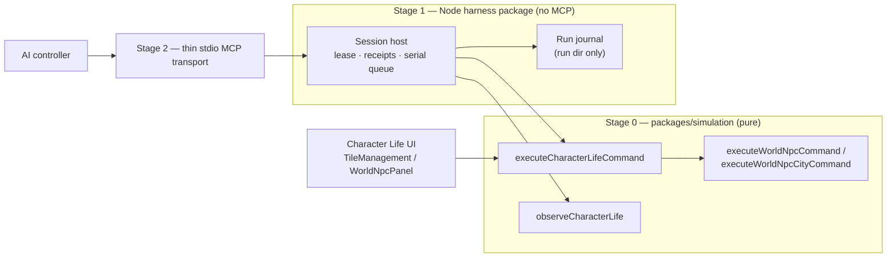
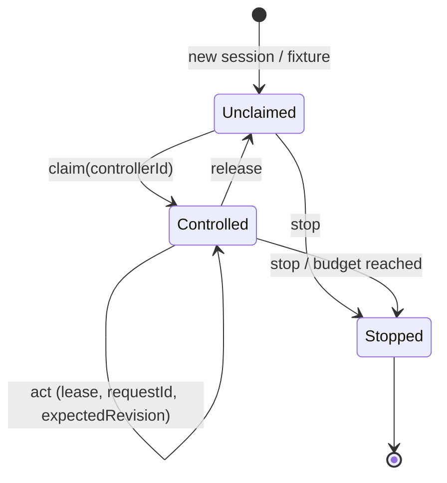

# SOLO-PLAYTEST-01 — Single-controller AI playtesting through a shared session boundary and a thin MCP adapter

Status: **APPROACH APPROVED · DESIGN DRAFT FOR REVIEW.** The user approved the staged combination route (option C) on 2026-10-26. This document itself is **not** user-approved and not a Work Package. It authorizes no product code, dependency, configuration, credential, network, server, push, PR or merge.
Baseline: `main` `f4aafa24e448aa10eec729c06767b9741adde9f9` (merge of PR #46, Character Foundation S1). Local `main` was stale; this baseline was not re-fetched in this task. **Before any implementation, re-verify baseline freshness and re-narrow allowed paths (§13).**
Excluded and protected: the unmerged QOL branch at `9503bba` (blocked on real 200% text / 400% zoom / Narrator checks). This design reads nothing from it and changes nothing in it.
Language: English.

Legend:
- **[APPROVED]** — decided by the user (source in §1).
- **[ENGINEERING]** — invariant or mechanism chosen by engineering; carries no user authority.
- **[PROPOSED]** — researcher choice in this draft, awaiting review of the design as a whole. Not approved by silence.
- **[QUESTION]** — consequential product/authorization question, listed in §16.

---

## 1. Authority and intent

| Item | Status | Source |
|---|---|---|
| Design for one Player; an AI (Claude or the Codex assistant) may play the game itself to find bugs and learn how it plays | APPROVED | User, 2026-10-26 ("thiết kế theo hướng 1 Player … bạn hoặc Claude tự mình chơi") |
| Solo first: events, QOL, running a whole city in the spirit of Free Cities | APPROVED priority | User, 2026-10-26 |
| Discuss the MCP design with Claude so both assistants can play-test | APPROVED request | User, 2026-10-26 |
| Staged combination (C): MCP play through game rules + separate real-GUI QA; shared boundary and tests first, MCP after verifying T3 client support | APPROVED approach | User, 2026-10-26 ("ok hãy làm đi") in reply to the assistant's summary of C |
| Everything else in this document | PROPOSED / ENGINEERING | This draft |

Intent: the AI acts as the single Player, chooses its own actions freely under the same rules and validation as the UI (not a prerecorded script), sees only what a human Player could see, plays in a test save, and leaves a log that reproduces any bug it finds.

## 2. Goals and non-goals

Goals:
1. One pure session command function used by both the Character Life UI and the adapter.
2. A player-visible observation projection with parity to the UI and no hidden state.
3. Exactly one controller per session; clean stop and handover that never performs game actions on its own.
4. Stale-revision rejection, durable request-id deduplication and a journal that recovers or refuses after a crash.
5. Test sessions isolated from the user's real save; reproducible from initial checkpoint + journal.
6. A thin local MCP transport, added only after a runtime compatibility checkpoint passes.

Non-goals (this design):
- Multiplayer, two simultaneous players, or AIs playing against each other.
- Implementing events, Choose/Skip, relationships, marriage, training, mortality, items, species or interactions. §9 reserves shapes only.
- Remote exposure, network listeners, authentication, credentials, cloud access to a local process.
- Replacing human GUI, layout, tooltip or accessibility QA. No WCAG certification claim.
- Changing game rules, balance, save format of real saves, or the QOL branch.

## 3. Alternatives and selection

- **A — headless only.** AI plays through game logic, no browser. Fast, deterministic, structured; blind to GUI and accessibility.
- **B — UI only.** AI drives the real build through host browser tools. Covers GUI; slow, layout-fragile, observations scraped. Currently blocked by a standing UI-control denial; not retried. An in-page `window.__haven` bridge is rejected: it ships test hooks in the product bundle and exposes raw state including the seed.
- **C — staged combination. [APPROVED]** A for rule-level play; real GUI/accessibility QA as an independent track (human, plus B only when host tools are permitted). Neither replaces the other.

## 4. Current baseline (code facts at `f4aafa24`)

| Concern | Fact | Reference |
|---|---|---|
| City commands | Allowlist, `expectedRevision`, phase gate, `expectedWeek` for End Week, clone-then-validate, all-or-nothing | [`executeTileTrialCommand`](../../../packages/simulation/src/tile-trial.ts) L4–61 |
| NPC post commands | Assign/unassign; city commands with post reconciliation; both bump the single `city.revision`; `LOAD_TRIAL` refused | [`world-npc.ts`](../../../packages/simulation/src/world-npc.ts) L10–36, L39–56, L33, L47 |
| Session composition | City + outside + npcs + player + profiles is assembled **in the UI**, not in a pure function | [`TileManagement.svelte`](../../../packages/ui/src/TileManagement.svelte) L70–93, L196; [`WorldNpcPanel.svelte`](../../../packages/ui/src/WorldNpcPanel.svelte) L18–25 |
| Phases | `planning` \| `report` only | [`trial/types.ts`](../../../packages/core/src/trial/types.ts) L8 |
| Week report | Returned by `END_WEEK`, held only in UI memory, cleared on load | `TileManagement.svelte` L86, L88 |
| Seed | Chosen by `crypto` in UI; used at creation for outside generation and NPC names | [`CharacterLifeApp.svelte`](../../../packages/ui/src/CharacterLifeApp.svelte) L19; [`character/session.ts`](../../../packages/core/src/character/session.ts) L95; [`world/npc.ts`](../../../packages/core/src/world/npc.ts) L69–74; [`world/generate.ts`](../../../packages/core/src/world/generate.ts) L57–73 |
| Weekly RNG | None found in [`tile-trial-week.ts`](../../../packages/simulation/src/tile-trial-week.ts) (bounded grep, not a proof) | — |
| Hidden state | Raw session holds `outside.seed` and every outside tile `feature`/`knownBy`; UI shows only an actor-filtered summary | [`world/types.ts`](../../../packages/core/src/world/types.ts) L4–5; [`summarizeOutside`](../../../packages/core/src/world/session.ts) L55; `TileManagement.svelte` L48 |
| Save codec | Character Life save, Planning only, 1 MiB cap | [`character-life-save.ts`](../../../packages/persistence/src/character-life-save.ts) L10, L12, L22 |
| Real browser slot | One key; Save locally overwrites it | [`character-life-session.ts`](../../../packages/ui/src/character-life-session.ts) L5, L21–32; detached load L10–19 |
| Events / relations | Not implemented; UI says so | `CharacterLifeApp.svelte` L51; planned in [Character Life design](2026-10-25-character-life-design.md) §11 |
| Package policy | Fixed allowed imports per package; no Node-only package exists | [`check-architecture.mjs`](../../../tools/check-architecture.mjs) L8–14 |
| Node consumption | `@haven/persistence` has no build script and exports `./src/index.ts`; headless import path unverified | [`persistence/package.json`](../../../packages/persistence/package.json) |

Existing tests to keep green and extend: [`tile-trial.test.ts`](../../../packages/simulation/src/__tests__/tile-trial.test.ts), [`world-npc.test.ts`](../../../packages/simulation/src/__tests__/world-npc.test.ts), [`character-life-save.test.ts`](../../../packages/persistence/src/__tests__/character-life-save.test.ts), [`character-life-session.test.ts`](../../../packages/ui/src/__tests__/character-life-session.test.ts), [`character-life.spec.ts`](../../../tests/e2e/character-life.spec.ts).

## 5. Architecture

Ownership [PROPOSED]:
- **Rules and validation:** existing `packages/simulation` functions. Unchanged.
- **Session boundary (Stage 0):** new pure `executeCharacterLifeCommand` and `observeCharacterLife` in `packages/simulation` (imports `core` only; satisfies LAW-02).
- **Harness (Stage 1):** new Node-only package (working name `packages/playtest`), policy entry `playtest: ['core', 'simulation', 'persistence']`; `ui` must not import it. All file I/O lives here.
- **Transport (Stage 2):** a thin layer in the same package that maps MCP tool calls to harness calls. No logic of its own.

## 6. Stage 0 — shared session boundary and observation parity

### 6.1 Command function [PROPOSED]
`executeCharacterLifeCommand(session, command) → { success: true; next; report? } | { success: false; error: { code; message } }`
- Accepts exactly today's player actions: `BUILD`, `REPLACE`, `UPGRADE`, `SET_WORKERS`, `SET_ENABLED`, `END_WEEK{expectedWeek}`, `NEXT_WEEK`, `ASSIGN_NPC`, `UNASSIGN_NPC`; all with `expectedRevision`.
- Routes city types through `executeWorldNpcCityCommand` and NPC types through `executeWorldNpcCommand`; passes `player`/`profiles` through unchanged; validates the result with `isCharacterLifeSessionState` ([`validate.ts`](../../../packages/core/src/character/validate.ts) L74).
- Rejects everything else (including `LOAD_TRIAL`, and future `CHOOSE`/`SKIP`) with `INVALID_COMMAND`/`UNSUPPORTED_ACTION`; state and revision unchanged.
- Character Life UI routes both city and NPC commands through it. Other modes stay on their current calls.

A shared function reduces drift; it does not prove equivalence. Parity tests (§12) are required on the final commit.

### 6.2 Observation projection [PROPOSED]
`observeCharacterLife(session, lastReport) → Observation`, built from an explicit **field allowlist** of what the Character Life UI renders today:
- week, phase, revision, actions enabled in this phase;
- active settlement stocks, residents/workforce, assigned workers, happiness, as shown;
- city tiles with terrain and building (type, level, workers, enabled), and the building catalogue values the UI shows;
- outside: `summarizeOutside(outside, 'player')` only;
- NPC cards and Player/NPC profiles under the same disclosure rules as the profile UI;
- last report: only fields the report UI renders (e.g. immigration *reason* fields stay out until the UI shows them).

Excluded: `outside.seed`, outside `feature`/`knownBy`, raw tiles of the outside map, undisclosed private profile fields, any RNG state or future-event data, file paths, internal hashes. Error messages are the same strings the UI shows.

### 6.3 Stage 0 deliverable
Library code + UI rewiring + tests. No harness, journal, MCP or runnable server is claimed.

## 7. Stage 1 — harness: controller, receipts, journal, stop

### 7.1 One controller [PROPOSED]

- One lease per session. A second `claim` while held → `CONTROLLER_BUSY`. `act` with a missing/old lease → `NOT_CONTROLLER`. No state change either way.
- One single-writer lock per run directory (exclusive create). A second process on the same run → refused. A stale lock after a crash is cleared only by an explicit harness `recover` step, never auto-stolen.
- **The lease is coordination, not authentication.** It grants nothing beyond the local process. No credentials are configured.
- Requests are processed serially; a `receipt` query is answered after any in-flight `act` completes.

### 7.2 Revision and durable idempotency [ENGINEERING]
- Every `act` carries `requestId`, `expectedRevision` (and `expectedWeek` for End Week). Existing checks reject stale commands.
- Receipt = `{ seq, requestId, payloadHash, leaseId, beforeRevision, afterRevision, resultCode, result }`. `payloadHash` = SHA-256 of canonical JSON of the action.
- Same `requestId` + same hash → stored receipt, no re-execution. Same `requestId` + different hash → `REQUEST_ID_REUSED`, no change.
- Rejected commands also get receipts (revision unchanged), so a retried rejection returns the same answer.
- MCP transport/request ids never replace this.

### 7.3 Journal and atomic commit [PROPOSED]
- Run directory under a harness-owned root (resolved path must stay inside it). Files: `journal.jsonl` (append-only), `lock`.
- Header record: build SHA, ruleset id, protocol/SDK pins (Stage 2), initial checkpoint (Character Life save text, Planning), its hash, seed, budget.
- **Commit point:** execute on a clone → append receipt + `stateHashAfter` as one line → flush to disk (`fsync`) → swap in-memory state → return. The journal line is the commit. Crash before the flushed line: the command did not happen. Crash after: recovery restores it and the receipt answers the retry.
- **Recovery:** load initial checkpoint, re-execute each recorded accepted action through `executeCharacterLifeCommand`, check each payload hash, revision step and `stateHashAfter`. An incomplete final line means that command did not commit: it is reported and treated as `not_committed`, and only an explicit harness `recover` step truncates it. A malformed line or any mismatch elsewhere → refuse to continue and report. No silent repair.
- Durability claims are limited to one process and one local disk with flush; cross-machine or networked storage is out of scope.

### 7.4 Uncertain outcome [ENGINEERING]
Timeout or cancellation is never rollback. Before retrying, the controller calls `receipt(requestId)`:
- `committed` → use the stored result;
- `not_committed` (no journal line after serial processing) → resubmit with the **same** `requestId`.
Mandatory for `END_WEEK`, `NEXT_WEEK` and every future choice.

### 7.5 Stop and handover [PROPOSED]
- `stop` voids the lease immediately; every later `act` → `SESSION_STOPPED`. `stop` is idempotent.
- `stop` never runs `NEXT_WEEK`, `END_WEEK` or a choice to reach an exportable phase.
- **Planning:** output a standard Character Life checkpoint via `serializeCharacterLifeSave` plus the journal.
- **Report (and future `resolving`):** the existing codec exports Planning only. Output the **harness checkpoint** = journal (initial checkpoint + receipts), from which replay restores the exact phase, report and pending context. It is a harness artifact the UI cannot import. The stop result states "standard export unavailable in this phase".
- **No automatic import into a real save.** The harness never writes browser storage. A human resumes only in an isolated playtest browser profile, or by an Import they choose themselves.
- Default run budget [PROPOSED]: stop at the first of 60 attempted actions (rejections count), 3 completed weeks, or operator stop. Stop on two identical consecutive failures, suspected corruption, or uncertain outcome that `receipt` cannot resolve. No automatic resume.

### 7.6 Fixtures and save isolation [PROPOSED]
- Sessions come only from `newSession{seed, presetId}` (uses `createCharacterLifeSession`) or `loadFixture{fixtureId}` from an allowlisted, committed fixture set read through `deserializeCharacterLifeSave`.
- Fixture source files are read-only inputs; never written.
- Seed: supplied by the operator or drawn by the harness; stored in the journal header; never returned by player tools.

## 8. Stage 2 — thin MCP transport

### 8.1 Runtime compatibility checkpoint (gate before Stage 2 starts) [PROPOSED]
Record, on the actual machine and clients:
1. Whether the T3 Claude and Codex clients can register and call a local stdio MCP server, and with which protocol revision.
2. The SDK package and exact version to pin (no automatic upgrade), with dependency-policy justification (reason, scope, size, maintenance).
3. Node version in use (agent notes record 24.22.1; re-verify).
4. How `@haven/persistence` (source-only exports) is consumed from Node.

The parent reported that the current official MCP pages resolve to revision `2026-07-28` (transports, tools); older session/handshake semantics must not be assumed. This document did not verify that. If the checkpoint fails, Stage 2 stops; Stages 0–1 remain useful through tests. Reachability of a local stdio process from a cloud parent is **not** promised.

### 8.2 Tools (illustrative names)
Player tools — legal moves only:
- `observe` → §6.2 observation.
- `act{leaseId, requestId, expectedRevision, action}` → receipt result.
- `receipt{requestId}` → `committed` + result, or `not_committed`.

Test-harness tools — explicitly labelled "harness", never player moves:
- `harness_new_session{seed?, presetId}`, `harness_load_fixture{fixtureId}`
- `harness_claim{controllerId}`, `harness_release`, `harness_stop`, `harness_status`

Never exposed: raw state, `LOAD_TRIAL`, file paths, eval, shell, journal contents, seed, hashes.

Tool annotations (read-only hints etc.) are untrusted hints; enforcement is in the harness.

## 9. Supported now versus future features

| Capability | Now (after Stage 0–2) | Future, separate approved specs |
|---|---|---|
| City build/replace/upgrade/workers/enable | Supported | — |
| NPC post assign/unassign | Supported | Planned same-building ban for Nemesis pairs |
| End Week / Next Week | Supported | `resolving` phase |
| Events, Choose, Skip | Rejected `UNSUPPORTED_ACTION` | `pendingChoices` in observation; `CHOOSE{occurrenceId, optionId}` / `SKIP{occurrenceId}` as explicit controller actions; Skip resolved by the game per [Character Life design §11.5](2026-10-25-character-life-design.md) with hidden seeded draw |
| NPC relationships | Not modelled | Observation shows only what the UI shows (e.g. range name) |
| Marriage | Not modelled | Explicit Player approval only |

Integration with the planned NPC relationship direction (relayed by parent; not implemented, not specified on this branch): one shared symmetric signed score per NPC pair; new pairs start at 0 (Neutral); ranges Rival [-100,-70], Hate [-69,-40], Annoyed [-39,-1], Neutral 0, Acquaintance [1,29], Like [30,69], Love [70,100]; milestone events; Love may produce a probabilistic marriage proposal that requires explicit Player approval and is never accepted by Skip; Rival mediation may yield Nemesis, which forbids the same building; marriage bonus when spouses share a building; bonus breakdown behind a brief hover. For the adapter this means only:
- milestone and proposal events arrive as `pendingChoices`; acceptance is an explicit `CHOOSE`;
- hover-level detail is observable only if the UI exposes it; no rates or rolls;
- in an authorized test session the AI-as-Player may make these choices; they never reach the user's real save (§7.5–7.6).
The existing NPC→Player 8-axis relation is untouched. No rates are invented here.

## 10. Replay and seeds [ENGINEERING]
- Replay = identical initial checkpoint + recorded actions through the same function. It reproduces state, not agent decisions.
- Today the seed affects only creation. Future Skip uses a seeded draw (design §11.5), so the seed stays hidden from player tools in every stage.

## 11. Trusted test-role limitation
The adapter limits what its tools return. It cannot stop a controller that also has file or shell tools from reading the journal, fixtures, seed or source. **Non-cheating is a test-harness policy:** playtest runs use a controller context without file/shell tools, or an audited no-read rule. A malicious controller with separate file tools is out of the adapter's power to prevent. Findings from runs that break the rule are discarded.

## 12. Tests and release gates

Tests are specified per stage; none has been written or run.

| # | Case | Stage | Expected evidence |
|---|---|---|---|
| T1 | Accepted parity | 0 | Same accepted sequences through the pre-change composition (existing NPC functions + player/profiles passthrough, as in `TileManagement.svelte` L70–93) and through `executeCharacterLifeCommand` → identical revisions, whole-session fields (city, outside, npcs, player, profiles) and report; existing UI e2e green on the final commit |
| T2 | Rejected parity | 0 | Same rejected commands (stale, wrong phase, invalid tile/building, workforce, locked/occupied post) → identical codes/messages, state unchanged |
| T3 | Unsupported features | 0 | `LOAD_TRIAL`, `CHOOSE`, `SKIP`, unknown types → rejected, state and revision unchanged |
| T4 | Hidden-information filter | 0 | Fixture with outside features set: observation keys ⊆ allowlist; deep scan finds no `seed`, `feature`, `knownBy`, undisclosed private values; outside counts equal `summarizeOutside(…,'player')` |
| T5 | Observation parity | 0 | e2e: rendered week, phase, stocks, NPC posts, outside summary equal projector output for the same fixture |
| T6 | Stale revision | 1 | `expectedRevision`/`expectedWeek` mismatch → rejection receipt, revision unchanged |
| T7 | Payload mismatch | 1 | Reused `requestId` with different hash → `REQUEST_ID_REUSED`, no change |
| T8 | Duplicate request | 1 | Same `requestId`+hash → stored receipt, executed once (End Week week advances once) |
| T9 | Uncertain timeout | 1 | Simulated lost response: `receipt` → committed result; simulated crash before flush: `not_committed`, resubmit succeeds once |
| T10 | Restart/replay | 1 | Clean journal replays to identical state hash; incomplete final line → `not_committed` until explicit `recover`; mid-journal mismatch → refusal |
| T11 | Stop in Planning | 1 | Lease void, later `act` → `SESSION_STOPPED`, standard checkpoint deserializes |
| T12 | Stop in Report | 1 | No phase change, "standard export unavailable", harness replay restores Report and report content |
| T13 | Two controllers | 1 | Second claim → `CONTROLLER_BUSY`; old lease → `NOT_CONTROLLER`; second process on same run dir refused |
| T14 | Protected bytes | 1 | Fixture file hashes unchanged after a run; run-dir resolver rejects escaping paths; harness package has no browser-storage reference and cannot import `ui` (architecture test) |
| T15 | Handover import | 1 | e2e: user-slot bytes in the default context unchanged; import works only in an isolated context/explicit Import |
| T16 | Transport mapping | 2 | Each tool maps to one harness call; schema rejects unknown fields; player tools expose no excluded data |

Release gates per stage [PROPOSED], using existing scripts: `npm run typecheck`, `npm run lint`, `npm test`, `npm run check:architecture`, `npm run test:architecture`, `npm run test:smoke` (Stage 0 touches UI wiring); CI `quality-gate`; independent review; human merge (G5). Evidence: commit hash, command, exit code, log (LAW-07).

GUI/accessibility gates are an independent track and are not satisfied by any test above.

## 13. Stages, allowed paths and pre-implementation checks [PROPOSED]

Before each stage: re-verify `main` freshness against `f4aafa24`; confirm QOL `9503bba` status and overlap (Stage 0 touches `TileManagement.svelte` and `WorldNpcPanel.svelte`, which the QOL work may also touch); re-narrow the paths below.

| Stage | Proposed allowed paths |
|---|---|
| 0 | `packages/simulation/src/character-life-command.ts`, `packages/simulation/src/character-life-observation.ts`, `packages/simulation/src/index.ts`, `packages/simulation/src/__tests__/character-life-*.test.ts`, `packages/ui/src/TileManagement.svelte`, `packages/ui/src/WorldNpcPanel.svelte`, one new `tests/e2e/*.spec.ts` |
| 1 | `packages/playtest/**` (new), `tools/check-architecture.mjs` policy entry, `tools/architecture.test.mjs`, root workspace config if required, fixture files under `packages/playtest` |
| R | No code: compatibility record only |
| 2 | `packages/playtest/**`, one pinned SDK dependency in `packages/playtest/package.json` + lockfile |

Each stage is its own Work Package (G1), branch, PR and human merge. Two-iteration hold rule applies.

## 14. Failure cases

| Failure | Handling |
|---|---|
| UI and adapter disagree | T1/T2/T5 block merge |
| Hidden data leaks into observation | T4 blocks merge; allowlist, not denylist |
| Two AIs race End Week | Lease + revision + receipts (T8, T13) |
| Lost response | `receipt` before retry (T9) |
| Crash mid-command | Journal commit point; recovery or refusal (T10) |
| Stop outside Planning | Harness checkpoint, no game action (T12) |
| Real save overwritten | Harness has no storage access; explicit import only (T14, T15) |
| MCP client unsupported | Stage 2 stops at checkpoint R |
| Controller reads files | §11 policy; findings discarded |

## 15. Research provenance
- MCP options note: [`docs/research/playtest/2026-10-26-solo-mcp-adapter-options.md`](../../research/playtest/2026-10-26-solo-mcp-adapter-options.md) (this branch).
- Earlier single-player AI playtest proposal and Solo QoL foundation inventory: `docs/research/playtest/2026-10-26-single-player-ai-playtest-proposal.md` and `docs/research/qol/2026-10-26-foundation-inventory.md` in the `research-npc-efficiency-01` worktree (not on this branch; unchanged).
- [Character Life design](2026-10-25-character-life-design.md) §11 (Choose/Skip, once-only).
- MCP protocol revision and transport notes: relayed by the parent from official pages; not independently verified here.
- Code references read at `f4aafa24` in this worktree; no build, test or runtime run.

## 16. Questions for the user [QUESTION]
1. **Merge order with QOL.** Stage 0 rewires `TileManagement.svelte`/`WorldNpcPanel.svelte`. Should it wait until the QOL branch `9503bba` merges, or go first and let QOL rebase?
2. **Who may start AI runs.** Proposal: runs start only on an explicit user or parent request, within the §7.5 budget; no scheduled or autonomous runs. Confirm or change.
3. **Marriage vs Skip (for the future relationship spec, not this design).** The approved Skip picks among enabled options by weighted draw; the planned marriage rule says Skip never accepts. The relationship spec must state how those combine (e.g. the acceptance option is excluded from Skip).

Other technical choices in this document are researcher proposals and are open to reviewer correction.
