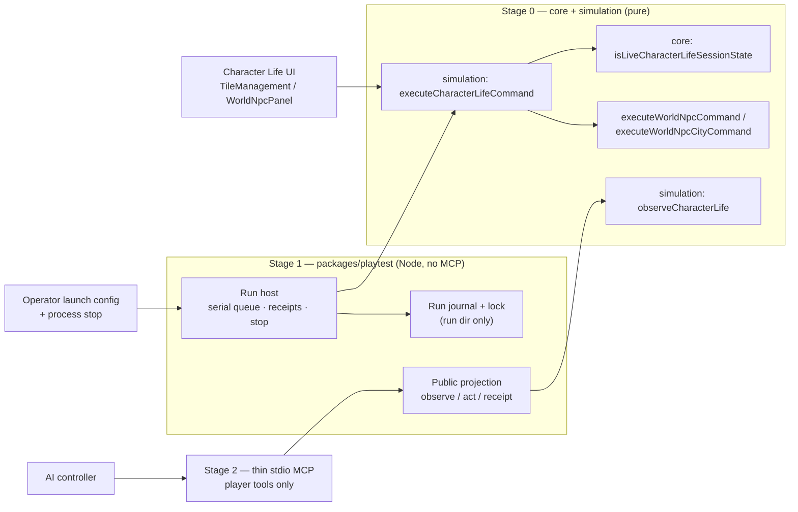

# SOLO-PLAYTEST-01 — Single-controller AI playtesting through a shared session boundary and a thin MCP adapter (v0.2)

Status: **APPROACH APPROVED · DESIGN DRAFT FOR REVIEW.** The user approved the staged combination route (option C) and prioritizing minimal current-feature MCP before new events (§1). This document itself is **not** user-approved and not a Work Package. It authorizes no product code, dependency, configuration, credential, network, server, probe, push, PR or merge. Review, design, plan and merge gates (AGENTS.md G0–G6) still apply.
Baseline: `main` `f4aafa24e448aa10eec729c06767b9741adde9f9` (merge of PR #46, Character Foundation S1). Local `main` was stale; this baseline was not re-fetched. **Before any implementation, re-verify baseline freshness and re-narrow allowed paths (§13).**
Excluded and protected: the unmerged QOL branch at `9503bba` (blocked on real 200% text / 400% zoom / Narrator checks). This design reads nothing from it and changes nothing in it.
Revision: v0.3. v0.2 (`761b751`) applied the independent Claude design review and Codex builder-readiness check of v0.1 (`2582081`). v0.3 applies their re-reviews of v0.2 (Stage 0 PASS, preserved; Stage 1 blockers) and the parent's engineering decisions. Disposition in §17.
Language: English.

Legend:
- **[APPROVED]** — decided by the user (source in §1).
- **[ENGINEERING]** — invariant or mechanism chosen by engineering; carries no user authority.
- **[PROPOSED]** — researcher choice in this draft, awaiting review of the design as a whole. Not approved by silence.

---

## 1. Authority and intent

| Item | Status | Source |
|---|---|---|
| Design for one Player; an AI (Claude or the Codex assistant) may play the game itself to find bugs and learn how it plays | APPROVED | User, 2026-10-26 ("thiết kế theo hướng 1 Player … bạn hoặc Claude tự mình chơi") |
| Solo first: events, QOL, running a whole city in the spirit of Free Cities | APPROVED priority | User, 2026-10-26 |
| Staged combination (C): MCP play through game rules + separate real-GUI QA; shared processing and tests first, MCP connected only after verifying T3 supports a suitable connection | APPROVED approach | Assistant summary "…làm nền xử lý chung và kiểm thử trước, rồi mới nối MCP sau khi xác minh T3 hỗ trợ đường kết nối phù hợp" → user "ok hãy làm đi", 2026-10-26 |
| Prioritize and proceed with minimal current-feature MCP before new events | APPROVED priority | User "ok vậy hãy tiến hành", 2026-10-26. Does not waive review/design/plan gates or grant credentials/network access |
| NPC relationship ranges and Love→marriage / Rival→Nemesis behaviour (future feature, §9) | APPROVED as future design input | User "ok tôi đồng ý …", 2026-10-26 (§9) |
| Everything else in this document | PROPOSED / ENGINEERING | This draft |

Intent: the AI acts as the single Player, chooses its own actions freely under the same rules and validation as the UI (not a prerecorded script), sees only what a human Player could see, plays in a test session, and leaves a journal that reproduces any bug it finds.

## 2. Goals and non-goals

Goals:
1. One pure, phase-aware session command function used by both the Character Life UI and the harness.
2. A player-visible observation projection with parity to the UI and no hidden state, and a public response boundary that leaks nothing through any other response.
3. Exactly one controller per run; clean stop and handover that never performs game actions on its own.
4. Stale-revision rejection, durable request-id deduplication and a journal that, after a crash, is verified and exported by terminal recovery or refused.
5. Test sessions isolated from the user's real save; reproducible from initial checkpoint + journal.
6. A thin local MCP transport, added only after a separately approved runtime compatibility checkpoint passes.

Non-goals:
- Multiplayer, two simultaneous players, or AIs playing against each other.
- Implementing events, Choose/Skip, relationships, marriage, training, mortality, items, species or interactions (§9 reserves shapes only).
- Remote exposure, network listeners, authentication, credentials, cloud access to a local process.
- Replacing human GUI, layout, tooltip or accessibility QA. No WCAG certification claim.
- Changing game rules, balance, the real save format, or the QOL branch.
- A disposable, non-durable run mode. Adopting one would be a material scope change requiring an explicit revised proposal.

## 3. Alternatives and selection

- **A — headless only.** AI plays through game logic, no browser. Fast, deterministic, structured; blind to GUI and accessibility.
- **B — UI only.** AI drives the real build through host browser tools. Covers GUI; slow, layout-fragile, observations scraped. Currently blocked by a standing UI-control denial; not retried. An in-page `window.__haven` bridge is rejected: it ships test hooks in the product bundle and exposes raw state including the seed.
- **C — staged combination. [APPROVED]** A for rule-level play; real GUI/accessibility QA as an independent track (human, plus B only when host tools are permitted). Neither replaces the other.

## 4. Current baseline (code facts at `f4aafa24`)

| Concern | Fact | Reference |
|---|---|---|
| City commands | Allowlist, `expectedRevision` (L11) then phase gate (L12–13) then type/fields (L18), clone-then-validate, all-or-nothing | [`executeTileTrialCommand`](../../../packages/simulation/src/tile-trial.ts) L4–61 |
| NPC post commands | Assign/unassign; city commands with post reconciliation; both bump the single `city.revision`; `LOAD_TRIAL` → `INVALID_COMMAND`; type read as own property | [`world-npc.ts`](../../../packages/simulation/src/world-npc.ts) L10–36, L39–56, L33, L46–47 |
| Phase-aware live validation | City command wrapper validates live city with `isTileTrialState`, NPCs with `isWorldNpcList`, and outside by pairing it with a fresh Planning city (comment L43–45) | `world-npc.ts` L42–45 |
| Planning-only validators | `isWorldSessionState` requires `isTileTrialPlanningState(city)`; `isNpcWorldSessionState` and `isCharacterLifeSessionState` inherit that | [`world/session.ts`](../../../packages/core/src/world/session.ts) L29–31; [`world/npc.ts`](../../../packages/core/src/world/npc.ts) L62–66; [`character/validate.ts`](../../../packages/core/src/character/validate.ts) L74–81 |
| Player/profile invariants | Player record, id, profession, age range, profile; NPC profiles index-aligned, adult age range, no Player id; `inAgeRange` is module-private | `validate.ts` L21, L62–71, L78–80 |
| Pinned live phases | Planning → Report → Planning through the NPC city wrapper | [`world-npc.test.ts`](../../../packages/simulation/src/__tests__/world-npc.test.ts) L166–170 |
| Session composition | City + outside + npcs + player + profiles assembled **in the UI** | [`TileManagement.svelte`](../../../packages/ui/src/TileManagement.svelte) L70–93, L196; [`WorldNpcPanel.svelte`](../../../packages/ui/src/WorldNpcPanel.svelte) L18–25 |
| Actionable ids in UI | Free manager slots as select options and labels | `WorldNpcPanel.svelte` L15, L55–57 |
| Phases | `planning` \| `report` only | [`trial/types.ts`](../../../packages/core/src/trial/types.ts) L8 |
| Week report | Returned by `END_WEEK`, held only in UI memory, cleared on load | `TileManagement.svelte` L86, L88 |
| Seed | Chosen by `crypto` in UI; used at creation only | [`CharacterLifeApp.svelte`](../../../packages/ui/src/CharacterLifeApp.svelte) L19; [`character/session.ts`](../../../packages/core/src/character/session.ts) L95; `world/npc.ts` L69–74; [`world/generate.ts`](../../../packages/core/src/world/generate.ts) L57–73 |
| Weekly RNG | None found in [`tile-trial-week.ts`](../../../packages/simulation/src/tile-trial-week.ts) (bounded grep, not a proof) | — |
| Hidden state | Raw session holds `outside.seed` and every outside tile `feature`/`knownBy`; UI shows only an actor-filtered summary | [`world/types.ts`](../../../packages/core/src/world/types.ts) L4–5; `summarizeOutside` `world/session.ts` L55; `TileManagement.svelte` L48 |
| Save codec | Character Life save, Planning only, 1 MiB cap | [`character-life-save.ts`](../../../packages/persistence/src/character-life-save.ts) L10, L12, L22 |
| Real browser slot | One key; Save locally overwrites it; Import does not restrict context | [`character-life-session.ts`](../../../packages/ui/src/character-life-session.ts) L5, L21–32; detached load L10–19 |
| Events / relations | Not implemented; UI says so | `CharacterLifeApp.svelte` L51; planned in [Character Life design](2026-10-25-character-life-design.md) §11 |
| Package policy | Fixed allowed imports per package; external bare specifiers are skipped | [`check-architecture.mjs`](../../../tools/check-architecture.mjs) L8–14, L253 |
| Node consumption | `core`, `simulation` and `persistence` all export TypeScript sources; standalone Node runtime loading unverified for all three | package manifests, e.g. [`persistence/package.json`](../../../packages/persistence/package.json) |
| Test discovery | Vitest includes `packages/**/*.test.ts` | [`vitest.config.ts`](../../../vitest.config.ts) |

Existing tests to keep green and extend: [`tile-trial.test.ts`](../../../packages/simulation/src/__tests__/tile-trial.test.ts), [`world-npc.test.ts`](../../../packages/simulation/src/__tests__/world-npc.test.ts), [`validate.test.ts`](../../../packages/core/src/character/__tests__/validate.test.ts), [`character-life-save.test.ts`](../../../packages/persistence/src/__tests__/character-life-save.test.ts), [`character-life-session.test.ts`](../../../packages/ui/src/__tests__/character-life-session.test.ts), [`character-life.spec.ts`](../../../tests/e2e/character-life.spec.ts).

## 5. Architecture



Ownership [PROPOSED]:
- **Rules and validation:** existing `packages/simulation` command functions, unchanged.
- **Live validation seam (Stage 0, core):** new exported `isLiveCharacterLifeSessionState` in `core/src/character/validate.ts`. A core seam is needed because the player/profile invariants use module-private `inAgeRange`; duplicating them in simulation would drift.
- **Session boundary (Stage 0, simulation):** new pure `executeCharacterLifeCommand` and `observeCharacterLife` (import `core` only; LAW-02).
- **Harness (Stage 1):** new Node-only package `packages/playtest`, policy `playtest: ['core', 'simulation', 'persistence']`; no package may import it. All file I/O lives here.
- **Transport (Stage 2):** a thin layer in `packages/playtest` mapping MCP calls to the public projection. No logic of its own.

## 6. Stage 0 — shared session boundary and observation parity

### 6.1 Live validation seam [PROPOSED]
`isLiveCharacterLifeSessionState(raw)` accepts Planning **and** Report:
1. exact keys `city, outside, npcs, player, profiles`;
2. `isTileTrialState(city)` (either phase);
3. outside valid via `isWorldSessionState({ city: createTileTrialState(), outside })` — same pattern as `world-npc.ts` L45;
4. `isWorldNpcList(npcs, city)`;
5. `isPlayerCharacter(player)`;
6. profiles: dense, same length as NPCs, each NPC within the character age range (`inAgeRange`: `CHARACTER_LIMITS` age min–max, as `validate.ts` L80), not the Player id, `isCharacterProfile(profiles[i], npcs[i].character)`.

Steps 5–6 move into one private helper shared with `isCharacterLifeSessionState`, whose behaviour stays exactly as today (strict, Planning-only; still used by the save codec and load path). No validation becomes passthrough.

### 6.2 Command function [PROPOSED]
`executeCharacterLifeCommand(session, raw) → { success: true; next; report? } | { success: false; error: { code; message } }`

Precedence (first match wins):

| # | Check | Code |
|---|---|---|
| 1 | `raw` not a plain object, or `type` (read with `Object.getOwnPropertyDescriptor(raw, 'type')?.value`) not a string | `INVALID_COMMAND` |
| 2 | `type === 'LOAD_TRIAL'` | `INVALID_COMMAND` (matches `world-npc.ts` L47) |
| 3 | `type` not one of the 9 supported actions (includes `CHOOSE`, `SKIP`, any unknown string) | `UNSUPPORTED_ACTION` |
| 4 | `!isLiveCharacterLifeSessionState(session)` | `INVALID_STATE`, message exactly "World session is invalid; nothing was changed." (same text as `world-npc.ts` L13) |
| 5 | Delegate exactly `{ city, outside, npcs }` (the wrappers require that exact 3-key shape; player/profiles are not passed and were already validated in step 4): `ASSIGN_NPC`/`UNASSIGN_NPC` → `executeWorldNpcCommand`; the other 7 → `executeWorldNpcCityCommand` | existing codes unchanged (`STALE_COMMAND`, `FORBIDDEN`, `WEEK_MISMATCH`, `INVALID_TILE`, `INVALID_BUILDING`, `INVALID_PLACEMENT`, `OCCUPIED`, `EMPTY_TILE`, `MAX_LEVEL`, `INSUFFICIENT_RESOURCES`, `INVALID_WORKFORCE`, `INVALID_PLAN`, NPC codes, `INVALID_COMMAND` for bad fields, `EXECUTION_ERROR`) |
| 6 | Assemble `{ ...next, player, profiles }` (fresh clones) and require `isLiveCharacterLifeSessionState` | `EXECUTION_ERROR`; input preserved |

Supported actions: `BUILD`, `REPLACE`, `UPGRADE`, `SET_WORKERS`, `SET_ENABLED`, `END_WEEK{expectedWeek}`, `NEXT_WEEK`, `ASSIGN_NPC`, `UNASSIGN_NPC`, each with `expectedRevision`. For these, semantics, codes and messages are exactly those of the delegated function. For unsupported types the wrapper intentionally differs from the legacy order (legacy returns `STALE_COMMAND`/`FORBIDDEN` first); parity is claimed only for supported types.

The Character Life UI routes city and NPC commands through this function; other modes stay on their current calls. A shared function reduces drift; it does not prove equivalence, so parity tests run on the final commit (§12).

### 6.3 Observation projection [PROPOSED]
`observeCharacterLife(session, lastReport) → Observation`, from an explicit **field allowlist** of what the Character Life UI renders:
- week, phase, revision; action types enabled in this phase;
- active settlement stocks, residents/workforce, assigned workers, happiness, as shown;
- **actionable catalogues:** every city tile id with terrain and building (type, level, workers, enabled); building catalogue entries the UI offers (`typeId`, name, cost, terrain, max level); NPC ids and names; current posts; free manager-slot tile ids with the UI slot label;
- disabled reasons only where the UI shows them (phase lock, "No free manager post …"); no precomputed validation outcomes the UI does not show;
- outside: `summarizeOutside(outside, 'player')` only;
- NPC cards and Player/NPC profiles under the same disclosure rules as the profile UI;
- last report: only fields the report UI renders (immigration reason fields stay out until the UI shows them).

Excluded everywhere: `outside.seed`, outside `feature`/`knownBy`, raw outside tiles, undisclosed private profile fields, RNG or future-event data, file paths, hashes, journal contents.

### 6.4 Stage 0 deliverable
Library code, UI rewiring and tests. No harness, journal, MCP or runnable server is claimed.

## 7. Stage 1 — harness: run host, public boundary, journal, stop

### 7.0 Pre-implementation verification (before the Stage 1 WP is approved) [PROPOSED]
Read-only inventory, no installs: (a) a `packages/playtest` tsconfig can typecheck against the three TS-source packages; (b) Vitest already discovers `packages/**/*.test.ts`; (c) whether a standalone Node 24 process can load `core`/`simulation`/`persistence` as published (TS sources with `.js` specifiers). If (c) fails, Stage 1 remains fully testable under Vitest and a runtime loading path becomes a named Stage 2 prerequisite, chosen without new dependencies where possible. (d) **Blocking:** the Stage 1 verification work must demonstrate an exclusive single-writer primitive meeting all four lifecycle properties of §7.5 on the target Windows host, with evidence per property. Until then Stage 1 cannot be accepted or run. (a)–(c) are read-only; (d) may need a small throwaway demonstration, which requires its own explicit approval and is not performed by this document.

### 7.1 Operator surface vs player surface [PROPOSED]
- **Operator launch configuration** (process arguments or a config file chosen by the human/parent): run root, run id, mode `new{seed?, presetId}` | `fixture{fixtureId}` | `fromCheckpoint{sourceRunId}` (Planning checkpoint exported by a stopped run) | `recover{runId}` (terminal, §7.4), controller label, budget. The seed, fixture and mode are fixed at launch. The AI cannot choose seeds, reset, load fixtures or checkpoints, take over a run or recover.
- **Player tools (Stage 2):** `observe`, `act`, `receipt` only.
- **Operator stop:** outside the player surface — ending the client session/stdin, process interrupt, or terminating the process (§7.6). No separate network admin channel.
- **Process ownership, not authentication.** The launching process owns the run for its lifetime; a second process on the same run is refused by the single-writer lock (§7.5). Ownership is not persisted: when the process ends, the run ends (§7.6). No credentials are configured; no secrets are written to logs (controller label only).
- **Operating cost [ENGINEERING, conservative by choice]:** a client disconnect or restart stops the run, and a restart never resumes it. Any client crash or reconnect ends the run; play continues only as a new run from an eligible Planning checkpoint.

### 7.2 Public response boundary [PROPOSED]
Internal types (never returned to the controller): command result with full `next` session and report; journal records; state hashes; header (seed, initial checkpoint); operator artifacts.

Public types:
```ts
type Observation = /* §6.3 allowlist */;
type PublicReceipt = {
  requestId: string;
  status: "committed";
  outcome: "accepted" | "rejected";
  code: string | null;        // existing error code when rejected
  message: string | null;     // same text the UI shows
  revisionBefore: number;
  revisionAfter: number;      // equals revisionBefore when rejected
  week: number; phase: "planning" | "report";
};
type ReceiptLookup = PublicReceipt
  | { requestId: string; status: "not_found" }          // this run processed no request with that id
  | { requestId: string; status: "recovery_required" };  // outcome unknown to this process (fsync fault); only operator recovery can classify it
type ActError = { code: "REQUEST_ID_REUSED" | "SESSION_STOPPED" | "RECOVERY_REQUIRED" | "OUTCOME_UNCERTAIN" | "INVALID_REQUEST"; message: string };
```
`act` returns `PublicReceipt` or `ActError`; the report is read via `observe`. `receipt` needs no ownership token and keeps working after stop for as long as the process is alive.

Run states of a live process: `active` (accepts `act`), `stopped` (terminal), `faulted` (terminal, after an `fsync` error). **Resubmitting a `not_found` request is allowed only while the same run is `active`**; in `stopped`/`faulted` every `act` is refused. `not_found` never means "resubmit into a stopped or recovered run".

### 7.3 Revision and durable idempotency [ENGINEERING]
- Every `act{requestId, expectedRevision, action}`; End Week also carries `expectedWeek` inside `action`. Existing checks reject stale commands.
- `payloadHash` = SHA-256 (lowercase hex) of canonical JSON (§7.4) of `{ expectedRevision, action }`. The controller label is excluded.
- Same `requestId` + same hash → stored receipt, no re-execution. Same `requestId` + different hash → `REQUEST_ID_REUSED`; not journaled, state unchanged.
- Rejected commands are journaled and flushed like accepted ones, so a retried rejection returns the same receipt.
- MCP transport/request ids never replace this.

### 7.4 Journal and atomic commit [PROPOSED]
File `journal.jsonl` in the run directory; one JSON record per line; each line carries `crc` = SHA-256 of its own body. Records:
- `header`: journal format version, run id, build SHA, ruleset id, initial checkpoint (Character Life save text, Planning), its hash, seed, budget, launch mode, and source run id + checkpoint hash when launched from another run's checkpoint.
- `command`: `seq`, `requestId`, `expectedRevision`, canonical `action`, `payloadHash`, `outcome`, `code`, `revisionBefore`, `revisionAfter`, `week`, `phase`, `stateHashAfter`, counters (`actionsAttempted`, `weeksCompleted`).
- `stop`: `seq`, reason (`operator`, `disconnect`, `budget`, `fault`), revision, phase.
- `recovered`: `seq`, bytes truncated, reason.

Definitions [ENGINEERING]:
- **Canonical JSON:** UTF-8; object keys sorted ascending by UTF-16 code units (default JS string sort); arrays in order; no whitespace; strings and numbers as `JSON.stringify` writes them. Inputs must be plain JSON data: `undefined`, functions, non-finite numbers or non-plain objects throw instead of being dropped. A small local helper with unit tests; no library.
- **`lastReport`:** the report returned by the most recent accepted `END_WEEK` in this run, or `null` before the first one; `NEXT_WEEK` does not clear it.
- **`stateHashAfter`:** SHA-256 (lowercase hex) of canonical JSON of `{ session, lastReport }` after the command, so a divergence only in the report is detected.

Linearization: the host processes one request at a time. For `act`: execute on a clone → append the record → `fsync` → swap in-memory state → reply. The reply is sent only after `fsync` returns.

**Recovery is terminal inspection and export, never continuation.** An existing run directory can only be opened by the operator in `recover` mode, which holds the same single-writer lock, exposes no player tools, and ends with the run stopped. It:
- **Refuses** if the header's journal format version, build SHA or ruleset id differs from the running build.
- Classifies a **complete record** (ends with newline, valid `crc`, replays to its recorded outcome, revisions and `stateHashAfter`) as **committed**, whether or not its `fsync` had returned. The controller never received a reply for it, so this is consistent.
- Classifies an **incomplete or crc-invalid final line** as a torn tail: that command is not committed. `recover` truncates it and appends a `recovered` record.
- Appends a `stop` record if none exists (reason `fault` or `disconnect`), preserving counters.
- Outputs to the operator: the receipts of all committed requests, `not_found` for any other id (meaning "no committed command was recovered", **not** permission to resubmit), and the artifacts of §7.6.

After recovery the operator may start a **separate** run from an eligible Planning checkpoint (new run id; header records the source run and checkpoint hash). Report-phase continuation is unsupported until a separate approved design.
- **Any complete record that fails to replay identically, or a bad line before the tail** → refuse to continue; report; no silent repair.
- Replay re-executes accepted **and rejected** records through `executeCharacterLifeCommand`; a rejected record must reproduce the same code with `revisionAfter = revisionBefore` and unchanged state hash.
- If `fsync` returns an error in a live process, the run becomes `faulted`: that request is answered `OUTCOME_UNCERTAIN`, its `receipt` answers `recovery_required`, every later `act` is refused, and only operator `recover` (terminal) classifies it.

Durability claims are limited to one process, one local disk and successful `fsync`; networked or cross-machine storage is out of scope.

### 7.5 Single writer and lock recovery [PROPOSED]
- One writer per run directory, for live runs and `recover` alike, enforced by an **exclusive single-writer primitive with verified lifecycle semantics**:
  1. while a holder lives, every other acquisition fails, including simultaneous attempts;
  2. when the holder dies by any means (exit, crash, kill), the OS releases it;
  3. no other process can release or steal it while the holder lives;
  4. the holder cannot lose it silently.
- **Stage 1 cannot be accepted or run until such a primitive is demonstrated** in its approved verification work (§7.0(d)). This document does not assert that Node built-ins provide one.
- Not acceptable: PID files (PIDs are reused), exclusive-create files alone (not released on death), operator confirmation, nonces or any other procedural fallback. There is no degraded mode.
- A local named pipe per run id is only a **candidate** to evaluate. It would be a local listener, so it would need explicit approval against the "no listeners" non-goal and must refuse every connection; listing it authorizes nothing.
- If no primitive is verified, Stage 1 stays blocked. Stage 0 is not affected. No new dependency is added for this without a separate dependency decision.

### 7.6 Stop, budgets and handover [PROPOSED]
- `stop` enters the same serial queue: an in-flight `act` finishes (commit or reject) first; then a `stop` record is appended and flushed; later `act` → `SESSION_STOPPED`. Idempotent.
- Stop never runs `NEXT_WEEK`, `END_WEEK` or a choice to reach an exportable phase.
- Triggers: operator stop, client disconnect/stdin end, budget reached, fault.
- Budget counters (`actionsAttempted`, `weeksCompleted`) are durable in every command record and the `stop` record, so they survive recovery. A stopped run stays stopped; recovery is terminal (§7.4). There is no implicit resume. Continuing play means a separate run launched from an eligible Planning checkpoint.
- Default budget [PROPOSED operator default, not user-approved]: stop at the first of 60 attempted actions (rejections count) or 3 completed weeks; also stop on two identical consecutive failures.
- **Planning:** operator artifact = standard Character Life checkpoint via `serializeCharacterLifeSave` + journal.
- **Report (and future `resolving`):** the codec exports Planning only. Operator artifact = harness checkpoint (journal with header), from which replay restores exact phase, report and pending context. The UI cannot import it. The stop result says "standard export unavailable in this phase". Continuing from Report is not supported in this design.
- **No automatic import into a real save.** The harness never touches browser storage. The current product does not enforce isolated import; the operator imports a Planning checkpoint into a fresh isolated browser context, and the real default slot changes only if the user explicitly chooses Save locally there.

### 7.7 Fixtures and save isolation [PROPOSED]
- Sessions come only from launch mode `new` (`createCharacterLifeSession`), `fixture` (allowlisted, committed fixtures) or `fromCheckpoint` (a stopped run's exported Planning checkpoint); the latter two are read through `deserializeCharacterLifeSave`. Each launch creates a new run id and journal.
- Fixture files are read-only inputs; run files are written only under the run root (resolved paths must stay inside it).
- Seed: operator-supplied or drawn by the harness; stored in the header; never in any public response.

## 8. Stage R and Stage 2 — compatibility, then thin MCP transport

### 8.1 Stage R — compatibility checkpoint (two steps) [PROPOSED]
- **R1, read-only inventory:** installed T3 Claude/Codex client versions; their documented MCP stdio support and config locations; documented protocol revisions; candidate SDK versions; Node version (agent notes say 24.22.1; re-verify). No edits, installs or runs.
- **R2, bounded throwaway probe — only if R1 cannot answer, and only after separate explicit approval:** a minimal stdio server outside the repo, a temporary client registration reverted afterwards, a fixed time box (e.g. 30 minutes). It proves client/server interoperability; R1 alone cannot.
- Neither R1 nor R2 is performed by this document. The parent reported the official MCP pages currently resolve to revision `2026-07-28`; older handshake/session semantics must not be assumed; this document did not verify it. The SDK version is pinned to a client-compatible version from R results, without automatic upgrade. Reachability of a local stdio process from a cloud parent is **not** promised. If R fails, Stage 2 stops; Stages 0–1 remain useful.

### 8.2 Stage 2 — player tools (illustrative names)
- `observe` → `Observation`.
- `act{requestId, expectedRevision, action}` → `PublicReceipt` | `ActError`.
- `receipt{requestId}` → `ReceiptLookup`.

Never exposed: operator modes, seed, fixture choice, recover, stop, raw state, `LOAD_TRIAL`, file paths, eval, shell, journal contents, hashes. Tool annotations are untrusted hints; enforcement is in the harness.

## 9. Supported now versus future features

| Capability | After Stages 0–2 | Future, separate approved specs |
|---|---|---|
| City build/replace/upgrade/workers/enable | Supported | — |
| NPC post assign/unassign | Supported | Same-building ban for Nemesis pairs |
| End Week / Next Week | Supported | `resolving` phase |
| Events, Choose, Skip | `UNSUPPORTED_ACTION` | `pendingChoices` in observation; `CHOOSE{occurrenceId, optionId}` / `SKIP{occurrenceId}` as explicit controller actions; Skip resolved by the game per [Character Life design §11.5](2026-10-25-character-life-design.md) with a hidden seeded draw |
| NPC relationships, marriage | Not modelled | Below |

Future integration only — approved by the user on 2026-10-26 ("ok tôi đồng ý …" after the proposed ranges), not implemented: one shared symmetric signed score per NPC pair; new pairs start at Neutral 0; ranges Rival [-100,-70], Hate [-69,-40], Annoyed [-39,-1], Neutral 0, Acquaintance [1,29], Like [30,69], Love [70,100]; two NPCs in Love may trigger a marriage event that starts only if the Player explicitly approves, then the relation becomes Marriage; Rival may trigger a Player mediation event that lowers hostility or escalates to Nemesis, and Nemesis pairs cannot work in the same building. Parent-relayed planned details (not user-quoted here): marriage bonus when spouses share a building; bonus breakdown behind a brief hover; no invented rates.

For this adapter that means only: events arrive as `pendingChoices`; marriage acceptance is an explicit `CHOOSE` and, in that future event, overrides the generic Skip rule (Skip never accepts a marriage); hover-level detail is observable only if the UI exposes it; in an authorized test run the AI-as-Player may make these choices, which never reach the user's real save (§7.6–7.7). The existing NPC→Player 8-axis relation is untouched.

## 10. Replay and seeds [ENGINEERING]
- Replay = identical initial checkpoint + recorded commands through the same function. It reproduces state, not agent decisions.
- Today the seed affects only creation. Future Skip uses a seeded draw, so the seed stays out of every public response in every stage.

## 11. Trusted test-role limitation
The harness limits what its public responses contain. It cannot stop a controller that also has file or shell tools from reading the journal, fixtures, seed or source. **Non-cheating is a test-harness policy:** playtest runs use a controller context without file/shell tools, or an audited no-read rule. A malicious controller with separate file tools cannot be prevented from cheating by this adapter alone. Findings from runs that break the rule are discarded.

## 12. Tests and release gates

Specified per stage; none has been written or run.

| # | Case | Stage | Expected evidence |
|---|---|---|---|
| T1 | Accepted parity | 0 | Same accepted sequences through the pre-change composition (existing NPC functions + player/profiles passthrough, as in `TileManagement.svelte` L70–93) and `executeCharacterLifeCommand` → identical revisions, whole-session fields (city, outside, npcs, player, profiles) and report; includes Planning → END_WEEK → Report → NEXT_WEEK → Planning |
| T2 | Rejected parity, supported types | 0 | Stale, wrong phase, invalid tile/building/placement, insufficient resources, workforce, locked/occupied post, bad fields → identical codes/messages to the delegated function; state unchanged |
| T3 | Wrapper taxonomy | 0 | Non-object command, or `type` missing as an own string property → `INVALID_COMMAND`; `LOAD_TRIAL` → `INVALID_COMMAND`; `CHOOSE`, `SKIP`, unknown → `UNSUPPORTED_ACTION` even when stale or in Report; invalid session → `INVALID_STATE`; state and revision unchanged |
| T4 | Live vs save validators | 0 | `isLiveCharacterLifeSessionState` accepts Planning and Report, rejects corrupt city/outside/npcs/player/profiles; `isCharacterLifeSessionState` results unchanged on the existing validate/save tests; Report session still not saveable |
| T5 | Observation allowlist and actionable ids | 0 | Keys ⊆ allowlist; contains tile ids, building catalogue, NPC ids, free slot ids; outside counts equal `summarizeOutside(…,'player')` |
| T6 | Observation UI parity | 0 | e2e: rendered week, phase, stocks, NPC posts, free slots, outside summary equal projector output for the same session |
| T7 | Privacy across all public outputs | 1 | Fixture with outside features set: deep scan of observe, accepted/rejected act, every `ReceiptLookup` and `ActError` finds no `seed` key or value, `feature`, `knownBy`, undisclosed private values, hashes, paths, journal fields |
| T8 | Stale revision | 1 | Mismatched `expectedRevision`/`expectedWeek` → rejected receipt, journaled, revision unchanged |
| T9 | Payload mismatch | 1 | Reused `requestId` with different `{expectedRevision, action}` → `REQUEST_ID_REUSED`, not journaled, no change; different controller label alone → same receipt |
| T10 | Duplicate request | 1 | Same `requestId`+hash → stored receipt; End Week executed once |
| T11 | Uncertain timeout | 1 | Lost reply after commit → `receipt` committed; request never received → `not_found` and resubmission accepted once while the run is `active`; injected `fsync` error → `OUTCOME_UNCERTAIN`, run `faulted`, that `receipt` → `recovery_required`, every later `act` refused |
| T12 | Recovery (terminal) | 1 | Clean journal (accepted + rejected records) replays to identical `stateHashAfter` including `lastReport`; complete record without returned `fsync` → committed; torn tail → truncated, `recovered` + `stop` records appended, its id reported `not_found`; no player tools and no `act` after recovery; mismatched journal format, build SHA or ruleset → refusal; mid-journal mismatch → refusal; canonical JSON helper unit tests (key order, throws on non-JSON input) |
| T13 | Stop in Planning | 1 | In-flight act completes first; stop record durable with counters; later `act` → `SESSION_STOPPED`; `receipt` still works while the process lives; standard checkpoint deserializes; `fromCheckpoint` launch creates a new run id |
| T14 | Stop in Report | 1 | No phase change; "standard export unavailable"; harness replay restores Report and report content; recovery keeps stopped state and counters; `fromCheckpoint` refuses a run without a Planning checkpoint |
| T15 | Single writer | 1 | Evidence for each §7.5 property on the target host: concurrent acquisitions → exactly one holder; holder killed → OS releases; no release/steal by another live process; holder loss detected; a second live process and a concurrent `recover` on the same run are refused; disconnect → `stop` record, restart does not resume |
| T16 | Protected bytes | 1 | Fixture file hashes unchanged after a run; run-root resolver rejects escaping paths |
| T17 | Boundaries (distinct checks) | 1 | (a) Architecture policy: nothing imports `playtest`; `playtest` imports only `core`/`simulation`/`persistence`, never `ui`. (b) No `node:` built-in imports in **production** sources of `core`/`simulation`/`persistence`, excluding tests the same way `check-architecture.mjs` does (`__tests__` dirs, `*.test.ts`/`*.spec.ts`); today only test files import `node:`. (c) No browser-storage dependency: `playtest` and `persistence` production sources reference no `localStorage`/`sessionStorage`/`indexedDB`/`window`; the browser slot helpers stay in `ui` (`character-life-session.ts`), unreachable by (a) |
| T18 | Handover import | 1 | e2e: an exported Planning checkpoint imports in a fresh isolated browser context; the default context's slot bytes are unchanged without an explicit Save locally |
| T19 | Transport surface | 2 | Only `observe`/`act`/`receipt` exist; schemas reject unknown fields; responses equal the Stage 1 public types |

Release gates per stage [PROPOSED], with existing scripts: `npm run typecheck`, `npm run lint`, `npm test`, `npm run check:architecture`, `npm run test:architecture`, `npm run test:smoke` where UI or e2e paths change; CI `quality-gate`; independent review; human merge (G5). Evidence: commit hash, command, exit code, log (LAW-07). GUI/accessibility gates are an independent track and are not satisfied by any test above.

## 13. Stages, allowed paths and pre-implementation checks [PROPOSED]

Before each stage: re-verify `main` freshness against `f4aafa24`; check QOL `9503bba` status; re-narrow the paths below.

| Stage | Proposed allowed paths |
|---|---|
| 0 | `packages/core/src/character/validate.ts`, `packages/core/src/character/__tests__/validate.test.ts`, `packages/simulation/src/character-life-command.ts` (new), `packages/simulation/src/character-life-observation.ts` (new), `packages/simulation/src/index.ts`, `packages/simulation/src/__tests__/character-life-*.test.ts` (new), `packages/ui/src/TileManagement.svelte`, `packages/ui/src/WorldNpcPanel.svelte`, one new `tests/e2e/*.spec.ts` for T6 |
| 1 | `packages/playtest/**` (new: `package.json`, `tsconfig.json`, `src/**`, `src/__tests__/**`, fixtures), root `package.json` (`typecheck:playtest` and its entry in `typecheck`), `package-lock.json` (workspace link only, no external dependency), `tools/check-architecture.mjs` (policy entry), `tools/architecture.test.mjs`, one new `tests/e2e/*.spec.ts` for T18 |
| R | None in the repo (R1 read-only; R2 outside the repo, separately approved) |
| 2 | `packages/playtest/**`, one pinned SDK dependency in `packages/playtest/package.json` + `package-lock.json` (dependency-policy justification required) |

Each stage is its own Work Package (G1), branch, PR and human merge; the two-iteration hold rule applies.

**Merge order with QOL [ENGINEERING, parent decision]:** Stage 0 is built on an isolated fresh base. QOL `9503bba` is not merged until its manual accessibility gates pass. Whichever lands second reconciles the shared UI paths (`TileManagement.svelte`, `WorldNpcPanel.svelte`) and reruns the exact required tests on its final commit before merge.

## 14. Failure cases

| Failure | Handling |
|---|---|
| End Week result rejected by a Planning-only validator | Live validator seam (§6.1); T1, T4 |
| UI and harness disagree | T1, T2, T6 block merge |
| Hidden data leaks via any response | Public types only (§7.2); T7 |
| AI resets or fishes seeds | Operator-only launch config (§7.1); T19 |
| Two AIs race End Week | One process per run, verified single-writer primitive, serial queue, revision, receipts (T10, T15) |
| Lost reply / crash before or after `fsync` | Receipt lookup while `active`; terminal recovery classification (T11, T12) |
| Stale writer after crash | Verified OS-released exclusive primitive; no PID, nonce or operator fallback; otherwise Stage 1 stays blocked (T15) |
| Client restart mid-run | Run stops; no resume; new run from a Planning checkpoint (T13–T15) |
| Stop outside Planning | Harness checkpoint, no game action (T14) |
| Real save overwritten | No storage access; isolated import procedure (T17, T18) |
| MCP client unsupported | Stage 2 stops at R |
| Controller reads files | §11 policy; findings discarded |

## 15. Research provenance
- Superseded options note: [`docs/research/playtest/2026-10-26-solo-mcp-adapter-options.md`](../../research/playtest/2026-10-26-solo-mcp-adapter-options.md).
- Earlier single-player AI playtest proposal and Solo QoL foundation inventory: `docs/research/playtest/2026-10-26-single-player-ai-playtest-proposal.md` and `docs/research/qol/2026-10-26-foundation-inventory.md` in the `research-npc-efficiency-01` worktree (not on this branch; unchanged).
- [Character Life design](2026-10-25-character-life-design.md) §11 (Choose/Skip, once-only).
- MCP protocol revision and transport notes: relayed by the parent from official pages; not verified here.
- Independent reviews of v0.1 `2582081`: Claude design review and Codex builder-readiness check (T3 review threads; final messages read only).
- Code references read at `f4aafa24` in this worktree; no build, test or runtime run.

## 16. Questions for the user
1. **Who may start AI runs.** Proposal: runs start only on an explicit user or parent request, within the operator budget; no scheduled or autonomous runs. Confirm or change.

Merge order and other technical choices are engineering decisions open to reviewer correction.

## 17. Review disposition (v0.1 → v0.2)

| Finding | Disposition |
|---|---|
| Planning-only validator rejects End Week (both reviews) | Fixed: §6.1 live seam in core, strict save validator unchanged; T1, T4; Stage 0 paths include core |
| Ambiguous rejection codes, precedence, own-property type | Fixed: §6.2 table; parity claimed for supported types only; T3 |
| Actionable ids missing from observation | Fixed: §6.3; T5 |
| Receipt/stop responses could leak state | Fixed: §7.2 public types; T7 |
| Journal lacked payload; hash scope; pre-`fsync` classification; rejected receipts; torn tail vs resubmit | Fixed: §7.3–7.4; T9, T11, T12 |
| Stale lock recovery without liveness; leases on restart; receipt after stop; stop vs in-flight; stopped state and budgets durable | Fixed in v0.2; lock and recovery wording superseded in v0.3 (below) |
| Node consumption deferred; vague root paths; distinct boundary checks | Fixed: §7.0, §13, T17 |
| Operator tools on the player surface | Fixed: §7.1, §8.2; T19 |
| Stage R "no code" yet proves interoperability | Fixed: §8.1 R1/R2, R2 separately approved, not performed |
| Options note contradicts design | Fixed: note marked superseded with corrections |
| T15 import isolation untestable | Fixed: T18 wording; product does not enforce isolation |
| Merge order asked of user | Fixed: §13 parent engineering decision |
| Attribution of staging order and relationship ranges | Fixed: §1 quotes; relationship ranges approved, future integration only; marriage explicit approval overrides Skip in that future event (§9) |
| Disposable-run alternative (readiness check) | Not adopted; would need an explicit revised proposal (§2) |

v0.2 → v0.3 (re-reviews of `761b751`; Stage 0 verdict PASS, semantics unchanged):

| Finding | Disposition |
|---|---|
| Lock fallback contradictory and not a mechanism (both re-reviews) | Fixed by parent decision: fallback removed; four verified lifecycle properties required; Stage 1 blocked until demonstrated; named pipe is a candidate only (§7.0(d), §7.5, T15) |
| `not_found` resubmit conflicts with terminal recovery | Fixed: recovery is terminal inspection/export; resubmit only while the same run is `active`; separate run from a Planning checkpoint (§7.2, §7.4, §7.6, T11, T12) |
| `stateHashAfter` undefined; build mismatch | Fixed: hash of canonical `{session, lastReport}`; canonical JSON defined; format/build/ruleset mismatch refuses recovery (§7.4, T12) |
| `node:` scan would hit test files | Fixed: production sources only, same exclusions as architecture tooling; browser-storage check split (T17) |
| Stage 0 minor notes | Clarified wording only: delegate exactly `{city, outside, npcs}`; fixed `INVALID_STATE` message; `inAgeRange` wording (§6.1–6.2); no behaviour change |
| Leftover "lease" wording; disconnect cost | Fixed: process ownership; conservative operating cost stated (§7.1) |
